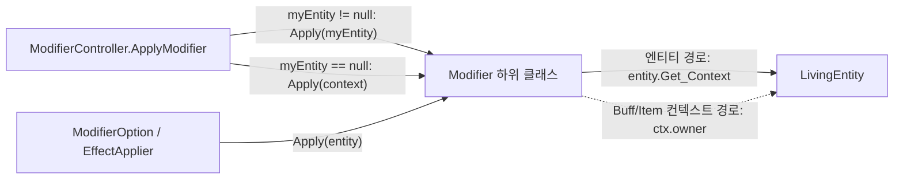

# Modifier 컨텍스트 적용 경로 추가 (엔티티 경로 + 컨텍스트 경로 병행)

- 작성일: 2026-10-23
- 상태: 구현 완료
- 관련 클래스: `Modifier`, `StatModifier`, `BuffModifier`, `DamageModifier`, `ActionModifier`, `ItemModifier`, `ModifierController`, `ModifierContext`, `LivingEntity`, `EntityStat`, `EquipSystem`, `CombatManager`, `SelectPanels`, `ItemSelectPanel`

---

## 0. 결정 기록 (모두 승인됨)

이전 판의 "결정 필요 항목" D1~D10, O1~O3은 사용자가 모두 답했다. 이 장은 그 결과를 기록만 한다. 남은 결정 항목은 없다.

| 항목 | 결정 | 상태 |
|---|---|---|
| 핵심 설계 | **두 경로를 모두 유지한다.** 하위 클래스의 기존 `Apply(LivingEntity)` override는 본문 그대로 둔다(나중에 순간이동처럼 엔티티 위치가 필요한 모디파이어를 위해). `Apply(ModifierContext)` override가 없는 하위 클래스에만 컨텍스트 전용 버전을 추가한다. 베이스 `Apply(LivingEntity)`의 기본 동작은 `Apply(entity.Get_Context(triggerType))`로 한다. | 승인됨 |
| 컨트롤러 | 지금 `modifier.Apply(myEntity)`를 호출하는 곳에서, `myEntity != null`이면 기존처럼 `Apply(myEntity)`를 호출하고, null이면 해당 트리거 컨텍스트로 `Apply(context)`를 호출한다. 이 분기는 private 헬퍼 하나에 둔다. | 승인됨 |
| D1, D2 | `StatModifier`/`DamageModifier`/`ActionModifier`/`ItemModifier`/`BuffModifier`의 `Apply(LivingEntity)` override는 **삭제하지 않는다.** | 승인됨 (삭제 안 함) |
| D3 | `BuffModifier`: 안 B. `Apply(LivingEntity)`는 그대로 두고, 새 `Apply(ModifierContext ctx)`에서 `ctx?.owner`가 null이면 return, 아니면 `Apply(ctx.owner)`. | 승인됨 |
| D4 | `ItemModifier`: `usingItem`이 null이면 적용하지 않고 `Debug.Log`를 남긴다. `Apply(LivingEntity)`와 `Apply(ModifierContext)` 양쪽에 적용한다. 컨텍스트 버전은 `ctx?.owner?.usingItem`을 쓴다. | 승인됨 |
| D5 | `ModifierContext`에 `usingItem` 필드를 추가하지 않는다. | 승인됨 (추가 안 함) |
| D6 | 패시브 이중 누적 수정. `RefreshPassiveModifiers`를 더티 플래그 + `GetUpdatedContext(Passive)`(Clear 후 재적용)로 바꾼다. | 승인됨 |
| D7 | `ApplyPassivesFrom`과 기존 `RefreshPassiveModifiers` 본문은 **삭제하지 않고 주석 처리**한다. 바꾼 이유를 짧은 주석으로 남긴다. | 승인됨 |
| D8 | `SetMyEntity`에서 기존 컨텍스트의 `owner`를 갱신하는 작업은 하지 않는다. | 승인됨 (하지 않음) |
| D9 | 오타 이름 변경은 T1~T9만 한다. T10~T15는 제외한다. T1 `multifle`은 프로젝트의 CSV/JSON/에셋/프리팹 데이터에 없다는 것을 사용자가 확인했다(코드 전용). | 승인됨 |
| D10 | `Modifier.cs`의 `using UnityEditor.Tilemaps;`를 삭제한다. | 승인됨 |
| O1~O3 | 대상 아님. O2/O3은 의도된 동작이라고 사용자가 확인했다. O1도 이번에는 다루지 않는다(15장). | 대상 아님 |

---

## 1. 개요

`Modifier`에 엔티티 없이도 동작하는 **컨텍스트 적용 경로**(`Apply(ModifierContext)`)를 모든 하위 클래스에 마련한다. 기존 **엔티티 적용 경로**(`Apply(LivingEntity)`)는 본문을 그대로 유지한다. `ModifierController`는 자기 엔티티가 있으면 지금처럼 엔티티 경로를, 없으면(종족/직업 선택 화면의 프리뷰용 `checker`) 컨텍스트 경로를 쓴다.

끝나면 다음이 달라진다.
- `checker`에 Passive 변이를 추가해도 NullReferenceException이 나지 않는다.
- Passive 모디파이어가 추가될 때 Passive 컨텍스트에 값이 두 번 쌓이던 버그가 사라진다.
- `ItemModifier`는 `usingItem`이 null이면 예외 대신 로그를 남기고 건너뛴다.
- 오타 식별자 T1~T9가 바로잡히고, 런타임 스크립트의 `UnityEditor` 참조가 사라진다.

## 2. 배경과 문제

### 2.1 NRE 재현 경로
- `Assets/Scripts/UIs/UI_SelectPanels/SelectPanels.cs` `UpdateCheckerModifiers()` (108~154줄): `checker = new ModifierController(); checker.InitAllContext(null);`이라서 `myEntity == null`. 이어서 `checker.AddMutation(newOption)`.
- `ModifierController.cs`: `AddMutation` → `AddModifierOptionInternal` → `AddModifierInternal` (88줄). trigger가 Passive이면 `RefreshPassiveModifiers()` (201줄) → `ApplyPassivesFrom` (208줄) → `modifier.Apply(myEntity)` (216줄).
- `Modifier.cs` `StatModifier.Apply(LivingEntity)` 138줄 `entity.Get_Context(triggerType)`에서 `entity`가 null이라 **NullReferenceException**. `DamageModifier`(300줄), `ActionModifier`(354줄)도 같은 패턴이고, `ItemModifier`(471줄)는 `entity.usingItem`에서 터진다.

### 2.2 순환 호출
`ModifierController` → `Modifier.Apply(LivingEntity)` → `LivingEntity.Get_Context` (LivingEntity.cs 74줄) → `modifierController.Get_Context`. 엔티티가 없으면 이 흐름이 성립하지 않는다. 이번 변경은 엔티티가 있을 때는 이 흐름을 그대로 두고(기존 동작 보존), 엔티티가 없을 때만 컨텍스트로 바로 적용한다.

### 2.3 패시브 이중 누적
10장 참조.

## 3. 결정 근거

- 채택: **두 경로 병행.** 사용자가 정했다. 하위 클래스의 엔티티 경로는 앞으로 엔티티 자체(위치 등)가 필요한 모디파이어를 위해 남긴다. 컨텍스트 경로는 엔티티가 없는 프리뷰에서 쓴다.
- 버린 안
  - `Apply(LivingEntity)`를 래퍼로 만들고 하위 override를 지우는 안(이전 판): 엔티티에 접근해야 하는 앞으로의 모디파이어 설계와 맞지 않아 사용자가 거절했다.
  - `SelectPanels`에서 임시 엔티티를 넘기는 안: `LivingEntity`는 MonoBehaviour라 `new`로 만들 수 없고, 프리뷰용 GameObject를 만들면 부작용이 크다.
  - 엔티티가 null이면 그냥 건너뛰는 안: 프리뷰 컨텍스트에 스탯이 반영되지 않는다.

## 4. 목표 / 비목표

- 목표
  - 5개 하위 클래스 모두 `Apply(ModifierContext)`를 가진다.
  - 엔티티가 있는 컨트롤러(플레이어/몬스터)의 동작은 지금과 같다(D6 이중 누적 수정과 D4 null 처리는 예외).
  - 엔티티가 없는 컨트롤러(`checker`)에서 예외가 나지 않는다.
  - 오타 T1~T9 수정, `using UnityEditor.Tilemaps;` 삭제.
- 비목표
  - 하위 클래스 `Apply(LivingEntity)` 본문 변경(`ItemModifier`의 null 처리만 예외).
  - `ModifierOption.Apply(LivingEntity)`, `EffectApplier.ApplySynchronized`, `LivingEntity.Get_Context` 변경.
  - `ModifierContext` 필드 추가.
  - `IsRestricted` / `CheckRestrictionModifiers` 변경.
  - 버프 지속시간, 턴 처리(`EventManager`, `TurnManager`) 변경.
  - `SelectPanels.cs`, `ItemSelectPanel.cs` 변경(수정 없이 NRE가 해소된다).
  - O1~O3, 오타 T10~T15.

## 5. 현재 구조

| 파일 | 역할 | 인코딩 |
|---|---|---|
| `Assets/Scripts/Items/ConsumableOptions/LivingEntity/Modifire/Modifier.cs` | `Modifier` 베이스와 하위 5종(`Assets/Scripts` 전체 grep 결과 이게 전부) | **레거시(CP949 추정)** |
| `.../Modifire/ModifierController.cs` | buffs/mutation/equips 딕셔너리, 트리거별 `contexts`, `dirtyFlags`, `myEntity` | UTF-8 |
| `.../Modifire/ModifierContext.cs` | `owner`, `stats`, `multifle`, `modifierActions`, `Clear()` | **레거시** |
| `.../Modifire/ModifierOption.cs` | `Apply(LivingEntity)` → 각 `modifier.Apply(entity)` | UTF-8(ASCII), 변경 없음 |
| `Assets/Scripts/Utis/EffectApplier.cs` | `ApplySynchronized` → `option.Apply(entity)` | UTF-8(ASCII), 변경 없음 |
| `Assets/Scripts/Entitys/LivingEntity.cs` | `modifierController` 필드 초기화, `Get_Context`, `usingItem`, `IsRistricted`, `ExcuteModifierActions` | **레거시** |
| `Assets/Scripts/Entitys/EntityStat.cs` | `CalculateContext` → `GetUpdatedContext`, `multifle` 읽음 | **레거시** |
| `Assets/Scripts/Entitys/EquipSystem.cs` | `OnChangeEquipMent()` 호출 | **레거시** |
| `Assets/Scripts/Managers/CombatManager.cs` | `ExcuteModifierActions` 호출 | **레거시** |
| `Assets/Scripts/UIs/UI_SelectPanels/SelectPanels.cs` | `checker` 생성, `InitAllContext(null)` | **레거시**, 변경 없음 |
| `Assets/Scripts/UIs/MainScene/SelectPanel/ItemSelectPanel.cs` | `checker.IsRestricted(...)`만 사용 | 변경 없음 |

### 5.1 `Apply` 호출부 (전체 grep)
- `ModifierOption.cs` 17줄 `modifier.Apply(entity);`
- `EffectApplier.cs` 23줄 `option.Apply(entity);` (`ItemBase.OnUse` 29줄에서 호출)
- `ModifierController.cs` 216줄 `modifier.Apply(myEntity);` (`ApplyPassivesFrom`)
- `ModifierController.cs` 258줄 `modifier.Apply(myEntity);` (`ApplyActiveModifiersFrom`)
- `Apply(ModifierContext)`를 직접 호출하는 곳은 현재 없다.

### 5.2 `myEntity` / `owner` 설정 시점
- `LivingEntity`는 필드 초기화로 `new ModifierController()`를 만들고 `InitAllContext`는 부르지 않는다.
- `PlayerEntity.Init` 380줄, `MonsterEntity.Init` 259줄에서 `base.Init()` 다음에 `SetMyEntity(this)`를 호출한다.
- 컨텍스트는 `Get_Context`에서 처음 요청될 때 `new ModifierContext(myEntity)`로 생긴다. `owner`는 그때 한 번만 정해진다.
- `InitAllContext`는 `SelectPanels`에서만 호출된다(null 전달).

## 6. 변경 설계

### 6.1 추가/변경되는 타입

> 모두 기존 파일 변경이다. 사용자 승인을 받았으므로 [수정 Mx 승인됨]으로 표시한다. 신규 파일/타입은 없다.

**Modifier (베이스) [M1 승인됨]**
```csharp
// 시그니처 유지(virtual). 지금은 빈 본문이다.
public virtual void Apply(LivingEntity entity)
{
    if (entity == null) return;
    Apply(entity.Get_Context(triggerType));
}
public virtual void Apply(ModifierContext context) { }   // 변경 없음(빈 virtual 유지)
```
- 지금 하위 5종은 모두 `Apply(LivingEntity)`를 override하므로 이 변경은 **현재 동작에 영향이 없다.** 앞으로 `Apply(ModifierContext)`만 구현하는 하위 클래스가 엔티티 경로로 불려도 동작하게 하려는 기본값이다.
- 재귀 주의: 하위 클래스가 `Apply(ModifierContext)` 안에서 `Apply(LivingEntity)`를 부르면서 `Apply(LivingEntity)`를 override하지 않으면, 베이스 래퍼 → `Apply(ctx)` → `Apply(entity)`로 무한 재귀가 된다. `BuffModifier`는 `Apply(LivingEntity)` override가 있으므로 안전하다(아래).

**StatModifier [변경 없음]**
- 이미 `Apply(ModifierContext)`가 있다. `Apply(LivingEntity)` override도 그대로 둔다(D1).

**DamageModifier [M2 승인됨]** — `Apply(ModifierContext)` override 추가
```csharp
// 기존 Apply(LivingEntity) 그대로 유지
public override void Apply(ModifierContext context)
{
    if (context == null) return;
    // 기존 Apply(LivingEntity) 301~319줄 본문을 그대로 복사하되
    // "ModifierContext context = entity.Get_Context(triggerType);" 줄만 뺀다.
    if (CanEvoke()) { /* isMulti 분기로 context.multifle / context.stats에 value 더하기 */ }
}
```

**ActionModifier [M3 승인됨]** — `Apply(ModifierContext)` override 추가
```csharp
// 기존 Apply(LivingEntity) 그대로 유지
public override void Apply(ModifierContext context)
{
    if (context == null) return;
    // 기존 355~380줄 본문을 그대로 복사. context.modifierActions만 사용한다.
}
```

**ItemModifier [M4 승인됨]** — 기존 `Apply(LivingEntity)`에 null 처리 추가 + `Apply(ModifierContext)` override 추가
```csharp
// 전
public override void Apply(LivingEntity entity)
{
    if (Utils.ItemModifierCheck(this,entity.usingItem))
    {
        ModifierContext context = entity.Get_Context(triggerType);
        ApplyModifiers(context);
    }
}
// 후
public override void Apply(LivingEntity entity)
{
    if (entity == null || entity.usingItem == null)
    {
        Debug.Log($"[ItemModifier] {id}: usingItem is null, skip apply");
        return;
    }
    if (Utils.ItemModifierCheck(this, entity.usingItem))
    {
        ModifierContext context = entity.Get_Context(triggerType);
        ApplyModifiers(context);
    }
}

// 추가
public override void Apply(ModifierContext context)
{
    ItemBase item = context?.owner?.usingItem;
    if (item == null)
    {
        Debug.Log($"[ItemModifier] {id}: owner or usingItem is null, skip apply");
        return;
    }
    if (Utils.ItemModifierCheck(this, item))
    {
        ApplyModifiers(context);
    }
}
```
- `ApplyModifiers(ModifierContext)` 헬퍼는 그대로 쓴다.
- 로그 문구는 영어로 쓴다(`Modifier.cs`가 CP949라 한글 문자열을 넣으면 인코딩 문제가 생길 수 있음. 11장).
- `usingItem`은 `LivingEntity.UseItem` 안에서만 잠깐 설정되고 끝에서 null로 돌아간다(128~141줄). 그래서 OnEquip/OnUseItem 컨텍스트를 다시 계산할 때 이 로그가 자주 찍힐 수 있다. 12장 위험 요소 참조.

**BuffModifier [M5 승인됨]** — 안 B, `Apply(ModifierContext)` override 추가
```csharp
// 기존 Apply(LivingEntity) override 그대로 유지(본문 변경 없음)
public override void Apply(ModifierContext context)
{
    LivingEntity owner = context?.owner;
    if (owner == null) return;
    Apply(owner);   // BuffModifier의 Apply(LivingEntity) override로 간다 → 재귀 없음
}
```
- `BuffModifier.Apply(LivingEntity)` override를 지우면 무한 재귀가 되므로 절대 지우지 않는다.

**ModifierController [M6 승인됨]** — private 헬퍼 추가 + 호출 교체
```csharp
// 추가: 엔티티가 있으면 기존 동작(엔티티 경로), 없으면 컨텍스트 경로
private void ApplyModifier(Modifier modifier, ModifierContext context)
{
    if (myEntity != null)
    {
        modifier.Apply(myEntity);   // 기존 동작 그대로
    }
    else
    {
        modifier.Apply(context);    // 프리뷰 checker 경로(엔티티 없음)
    }
}

// 변경: ApplyActiveModifiersFrom (시그니처 유지)
private bool ApplyActiveModifiersFrom(Dictionary<ModifierTriggerType, List<Modifier>> targetDict, ModifierTriggerType type)
{
    bool removedAny = false;
    if (targetDict.TryGetValue(type, out var list) && list.Count > 0)
    {
        ModifierContext context = Get_Context(type);   // 추가
        foreach (var modifier in list)
        {
            ApplyModifier(modifier, context);           // 변경: modifier.Apply(myEntity) → 헬퍼
        }
    }
    return removedAny;
}
```
- `type`으로 꺼낸 리스트의 모디파이어는 `AddModifierInternal`에서 `mod.triggerType`을 키로 들어갔으므로 `modifier.triggerType == type`이다. 따라서 `Get_Context(type)`은 엔티티 경로의 `entity.Get_Context(modifier.triggerType)`과 같은 컨텍스트 객체다.
- `ApplyPassivesFrom`(216줄)의 호출은 M7(D6/D7)에서 메서드 전체가 주석 처리되므로 헬퍼로 바꾸지 않는다. 패시브 적용은 `GetUpdatedContext(Passive)` → `ApplyActiveModifiersFrom` → 헬퍼를 거친다.
- `ModifierController.cs`는 UTF-8이라 한글 주석을 넣어도 된다.

**ModifierController [M7 승인됨]** — 패시브 이중 누적 수정(10장)

**Modifier.cs [M8 승인됨]** — `using UnityEditor.Tilemaps;` 삭제(6줄)

**오타 수정 [M9 승인됨]** — 14장 T1~T9

### 6.2 데이터 흐름 (변경 후)

1. **생성**: `ModifierManager`가 풀에서 `Modifier`/`ModifierOption`을 꺼낸다(변경 없음).
2. **등록**: `AddMutation/AddEquipment/AddBuff` → `AddModifierInternal` → 리스트에 추가, `dirtyFlags[trigger] = true`, `OnModifierChanged`. Passive이면 `RefreshPassiveModifiers()` → `GetUpdatedContext(Passive)`(M7).
3. **적용**
   - 컨트롤러 경로: `GetUpdatedContext(type)` → dirty이면 `context.Clear()` → `ApplyActiveModifiersFrom(…, type)` → `ApplyModifier(modifier, context)`
     - 엔티티 있음: `modifier.Apply(myEntity)` → 하위 override(기존 로직) → `entity.Get_Context(triggerType)`(같은 컨텍스트)에 기록
     - 엔티티 없음(`checker`): `modifier.Apply(context)` → 하위 컨텍스트 override. Buff와 Item은 `owner`가 null이라 건너뛴다(Item은 로그 남김).
   - 엔티티 경로(소비 아이템): `ItemBase.OnUse` → `EffectApplier.ApplySynchronized` → `modifier.Apply(entity)` → 하위 override(변경 없음)
4. **턴 경과**: 변경 없음(`EventManager`가 endTurn 기준으로 `Remove_BuffModifier`).
5. **해제**: `RemoveModifiernInternal`(T4 이후 `RemoveModifierInternal`) → dirty → 다음 `GetUpdatedContext`에서 Clear 후 재적용(변경 없음).



### 6.3 생명주기와 소유권
- `ModifierContext`는 `ModifierController`가 만들고 보관한다. `owner`는 생성 시점의 `myEntity`이며 이번 변경으로 바뀌지 않는다(D8).
- `checker`는 `SelectPanels.UpdateCheckerModifiers`가 매번 새로 만든다. 모든 컨텍스트의 `owner`가 null이다. Stat/Damage/Action은 checker 컨텍스트에 값을 쓴다(프리뷰 전용이라 게임에 영향 없음). Buff/Item은 건너뛴다.
- Modifier/ModifierController/ModifierContext는 모두 순수 C# 객체다. MonoBehaviour 생성 문제는 없다.
- 미리보기와 실제 적용: `checker`는 플레이어와 별개의 컨트롤러이고, 실제 적용은 `Create_Character`에서 풀에서 새로 꺼낸 옵션으로 한다. 변경 없음.

### 6.4 그리드 데이터 영향
없음. 그리드 좌표, 점유, 시야, 사거리, 이동 판정 코드는 건드리지 않는다. 스탯 수치는 D6 수정으로 Passive 이중 누적이 사라지는 것 말고는 그대로다.

## 7. 영향 범위

| 파일 | 종류 | 내용 |
|---|---|---|
| `Assets/Scripts/Items/ConsumableOptions/LivingEntity/Modifire/Modifier.cs` | 수정(승인됨) | M1 베이스 기본 동작, M2~M5 컨텍스트 override 추가와 Item null 처리, M8 using 삭제, T1·T2·T3 |
| `Assets/Scripts/Items/ConsumableOptions/LivingEntity/Modifire/ModifierController.cs` | 수정(승인됨) | M6 헬퍼와 호출 교체, M7 패시브 수정(옛 코드는 주석 처리), T1·T4·T6·T7 |
| `Assets/Scripts/Items/ConsumableOptions/LivingEntity/Modifire/ModifierContext.cs` | 수정(승인됨) | T1·T8만(필드 추가 없음) |
| `Assets/Scripts/Entitys/LivingEntity.cs` | 수정(승인됨) | T5·T8·T9만 |
| `Assets/Scripts/Entitys/EntityStat.cs` | 수정(승인됨) | T1만 |
| `Assets/Scripts/Entitys/EquipSystem.cs` | 수정(승인됨) | T7만 |
| `Assets/Scripts/Managers/CombatManager.cs` | 수정(승인됨) | T9만 |
| `ModifierOption.cs`, `EffectApplier.cs`, `SelectPanels.cs`, `ItemSelectPanel.cs` | 변경 없음 | |

## 8. 기존 코드 수정 승인

사용자가 모두 승인했다.

- [x] M1. `Modifier.cs` — 베이스 `Modifier.Apply(LivingEntity)`의 빈 본문을 `if (entity == null) return; Apply(entity.Get_Context(triggerType));`로
  - 이유: 앞으로 컨텍스트 버전만 구현하는 하위 클래스도 엔티티 경로에서 동작하게 하려고.
  - 기존 동작 영향: 없음(하위 5종이 모두 override함).
- [x] M2. `Modifier.cs` — `DamageModifier.Apply(ModifierContext)` override 추가. 기존 `Apply(LivingEntity)`는 그대로.
  - 기존 동작 영향: 없음. 새 메서드는 `checker` 경로에서만 불린다.
- [x] M3. `Modifier.cs` — `ActionModifier.Apply(ModifierContext)` override 추가. 기존 override는 그대로.
  - 기존 동작 영향: 없음.
- [x] M4. `Modifier.cs` — `ItemModifier.Apply(LivingEntity)`에 null 처리 + `Debug.Log` 추가, `Apply(ModifierContext)` override 추가(D4).
  - 기존 동작 영향: `usingItem == null`일 때 NullReferenceException → 로그를 남기고 건너뜀.
  - 변경 전/후: 6.1 참조.
- [x] M5. `Modifier.cs` — `BuffModifier.Apply(ModifierContext)` override 추가(D3 안 B). 기존 `Apply(LivingEntity)`는 그대로.
  - 기존 동작 영향: 없음.
- [x] M6. `ModifierController.cs` — private 헬퍼 `ApplyModifier(Modifier, ModifierContext)` 추가, `ApplyActiveModifiersFrom` 258줄을 헬퍼 호출로 교체.
  - 이유: 엔티티가 없는 컨트롤러에서 생기는 NRE를 해결하려고.
  - 기존 동작 영향: `myEntity != null`이면 그대로.
  - 변경 전/후:
    ```csharp
    // 전
    foreach (var modifier in list) { modifier.Apply(myEntity); }
    // 후
    ModifierContext context = Get_Context(type);
    foreach (var modifier in list) { ApplyModifier(modifier, context); }
    ```
- [x] M7. `ModifierController.cs` — 패시브 이중 누적 수정(D6). 기존 `RefreshPassiveModifiers` 본문과 `ApplyPassivesFrom`은 주석 처리(D7). 10장 참조.
  - 기존 동작 영향: Passive 컨텍스트가 2배로 남던 현상이 사라진다. Passive `BuffModifier`의 `AddBuff` 호출 횟수가 바뀐다(10.3).
- [x] M8. `Modifier.cs` — `using UnityEditor.Tilemaps;` 삭제(D10).
  - 이유: 런타임 스크립트가 `UnityEditor`를 참조하면 플레이어 빌드에서 컴파일 에러가 난다. 쓰는 곳이 없다.
- [x] M9. 오타 식별자 이름 변경 T1~T9(D9). 14장 참조.

## 9. 에디터 수동 작업
없음. (T10~T15는 제외했으므로 직렬화 필드나 폴더 이름 변경이 없다.)

## 10. 패시브 이중 누적 수정 (M7)

### 10.1 현상
`ModifierController.AddModifierInternal`(88~109줄)에서 trigger가 Passive일 때 다음 순서로 진행된다.
1. `dirtyFlags[Passive] = true`
2. `OnModifierChanged?.Invoke(mod)`: 엔티티가 구독한 경우 `LivingEntity.OnModifierChange` → `EntityStat.CalculateContext(Passive)` → `GetUpdatedContext(Passive)` → **Clear 후 전체 재적용(정상, 1배)**, dirty=false
3. `RefreshPassiveModifiers()` → `ApplyPassivesFrom(mutation/equips/buffs)` → Clear 없이 **모든 Passive 모디파이어를 한 번 더 더함(2배)**, dirty=false

결과
- 엔티티: 2단계에서 계산한 `finalStat` 캐시는 맞지만 Passive 컨텍스트는 2배로 남는다. dirty가 false라서 이후 HP 변화 등으로 `EntityStat.MarksAsDirty()` → `CalculateContext` → `GetUpdatedContext(Passive)`가 2배 컨텍스트를 그대로 읽어 스탯이 과다 계산된다. 다음에 Passive가 dirty가 될 때까지 계속된다.
- `checker`(구독자 없음): 2단계가 없다. 그래서 k번째 Passive 모디파이어를 추가할 때마다 1~k번째가 모두 다시 더해진다(1+2+…로 누적).
- `ApplyPassivesFrom`의 `ModifierContext context = Get_Context(trigger);`는 결과를 쓰지 않는다.

### 10.2 수정
```csharp
private void RefreshPassiveModifiers()
{
    // AddModifierInternal에서 이미 dirtyFlags[Passive] = true로 설정됨.
    // Clear 후 mutation/equips/buffs 순서로 1회 재적용한다(GetUpdatedContext와 같은 경로).
    GetUpdatedContext(ModifierTriggerType.Passive);

    // [이전 구현 - 주석 처리]
    // 컨텍스트를 Clear하지 않고 모든 Passive 모디파이어를 다시 더해서
    // Passive 값이 이중/누적으로 쌓이는 버그가 있어 위 방식으로 교체함.
    // ApplyPassivesFrom(mutation);
    // ApplyPassivesFrom(equips);
    // ApplyPassivesFrom(buffs);
}

// [이전 구현 - 주석 처리] RefreshPassiveModifiers 교체로 더 이상 호출되지 않음(위 주석 참조).
// private void ApplyPassivesFrom(Dictionary<ModifierTriggerType, List<Modifier>> targetDict)
// {
//     ... 기존 본문 그대로 줄마다 // 를 붙임 ...
// }
```
- `GetUpdatedContext(Passive)`는 Clear 후 mutation → equips → buffs 순서로 `ApplyActiveModifiersFrom(…, Passive)`를 호출한다. 기존 `ApplyPassivesFrom`과 대상과 순서가 같다.
- "더티" 부분: `RefreshPassiveModifiers`는 `AddModifierInternal`에서만 호출되고, 그 바로 위에서 `dirtyFlags[trigger] = true`가 이미 설정된다. 그래서 여기서 다시 true로 강제하지 않는다.
  - `checker`: dirty가 true이므로 Clear 후 1회 재적용된다.
  - 엔티티: 2단계에서 이미 재계산되어 dirty가 false이므로 no-op이 된다(중복 계산 없음).
- 주석 처리한 코드는 지우지 않는다(D7). `ModifierController.cs`는 UTF-8이라 한글 주석을 써도 된다.

### 10.3 동작 변화
- Passive 컨텍스트 값이 항상 1배가 된다.
- Passive 트리거 `BuffModifier`: 엔티티 기준으로 Passive 하나를 추가할 때 `BuffModifier.Apply` → `EventManager.AddBuff` 호출이 2회(2단계 + 3단계)에서 1회(2단계)로 줄어든다. O3(`Add_Buff` 이중 등록)은 사용자가 의도된 동작이라고 했지만, 이 횟수 변화는 이번 수정의 부수 효과이므로 검증 항목에 넣었다.

## 11. 작업 단계

> **인코딩 주의 (필수)**: `Modifier.cs`, `ModifierContext.cs`, `LivingEntity.cs`, `EntityStat.cs`, `EquipSystem.cs`, `CombatManager.cs`(그리고 변경 대상은 아닌 `SelectPanels.cs`, `PlayerEntity.cs`, `MonsterEntity.cs`)는 UTF-8이 아니다(CP949/EUC-KR 추정, 한글 주석이 깨져 보임). Edit/Write 도구는 이 파일을 거부하거나 UTF-8로 다시 써서 한글 주석을 망가뜨린다.
> - 사용자에게 묻지 않고 UTF-8로 변환하지 않는다.
> - 셸에서 인코딩을 유지한 채 고친다. 예: PowerShell `$enc = [System.Text.Encoding]::GetEncoding(949); $t = [System.IO.File]::ReadAllText($path, $enc); ...치환...; [System.IO.File]::WriteAllText($path, $t, $enc)`. 줄바꿈(CRLF/LF)도 원본과 같게 유지한다.
> - 레거시 파일에 새로 넣는 주석과 `Debug.Log` 문자열은 영어로 쓴다.
> - 수정 후 `git diff`로 의도한 줄 말고 한글 주석 줄이 바뀌지 않았는지 확인한다.
> - `ModifierController.cs`는 UTF-8이라 일반 편집이 가능하다.

- [x] 1. [M8] `Modifier.cs`에서 `using UnityEditor.Tilemaps;` 삭제 → 컴파일 가능
- [x] 2. [M1] 베이스 `Apply(LivingEntity)` 기본 동작 작성 → 컴파일 가능, 동작 변화 없음
- [x] 3. [M2, M3, M5] Damage/Action/Buff에 `Apply(ModifierContext)` override 추가 → 컴파일 가능, 아직 호출부 없음
- [x] 4. [M4] Item의 `Apply(LivingEntity)` null 처리 + `Apply(ModifierContext)` 추가 → 컴파일 가능
- [x] 5. [M6] `ModifierController`에 `ApplyModifier` 헬퍼 추가, `ApplyActiveModifiersFrom` 교체 → 컴파일 가능. 이 시점에는 `ApplyPassivesFrom` 216줄이 아직 `Apply(myEntity)`라서 `checker` NRE가 남아 있다.
- [x] 6. [M7] `RefreshPassiveModifiers` 교체, 옛 본문과 `ApplyPassivesFrom` 주석 처리 → 컴파일 가능. 여기서 `checker` NRE가 해소된다.
- [x] 7. [M9] 오타 T1~T9. 식별자 하나씩 `Assets/Scripts` 전체 grep으로 참조를 다시 확인하고, 바꿀 때마다 컴파일한다. 3~4단계에서 새로 추가한 코드 안의 `multifle`도 T1 대상이다(참조 수가 14장 표보다 늘어나 있다).

## 12. 검증

### 플레이 모드 시나리오
- [ ] 메인 씬 종족 선택 화면에서 Passive 변이가 있는 종족을 고른다 → 콘솔에 NullReferenceException이 없다.
- [ ] 종족과 직업 선택을 여러 번 바꿔도 예외가 없고, 직업별 시작 아이템 목록(`IsRestricted` 결과)이 전과 같다.
- [ ] 캐릭터를 만들고 던전에 들어간다 → 플레이어 스탯 UI가 종족/직업 패시브를 1배로 반영한다. 피격 등으로 HP가 바뀐 뒤에도 다른 스탯이 변하지 않는다(이중 누적 해소 확인).
- [ ] 장비 장착/해제 → OnEquip 컨텍스트와 스탯이 전과 같다.
- [ ] OnAttack/OnHited/AfterAttack `ActionModifier`(예: LifeSteel)가 전과 같이 동작한다.
- [ ] `DamageModifier` 발동 확률이 전과 같다.
- [ ] 버프 2개 이상인 소비 아이템 사용 → `EffectApplier`로 같은 지속시간의 버프가 걸리고 만료 턴에 풀린다.
- [ ] `ItemModifier`가 붙은 변이 상태에서 해당 카테고리 아이템을 사용/장착 → 보정이 적용된다.

### 경계 상황
- [ ] `checker`에 `BuffModifier`/`ItemModifier`가 든 옵션을 추가 → 예외 없이 건너뛴다(Item은 로그).
- [ ] `usingItem == null` 상태에서 OnEquip/OnUseItem 컨텍스트를 다시 계산 → 예외 없이 `[ItemModifier] ... skip apply` 로그가 찍힌다.
- [ ] 같은 Passive 변이 여러 개를 연달아 추가 → 값이 개수만큼만 늘어난다(엔티티와 `checker` 둘 다).
- [ ] Passive 트리거 `BuffModifier`가 있는 변이를 추가 → 버프 등록 횟수가 1회다(10.3).
- [ ] 풀에서 꺼낸 몬스터가 스폰 직후 공격/피격 → 엔티티 경로로 동작하고 버프가 올바른 대상에 걸린다.
- [ ] 세이브 후 로드 → 변이/버프 복원 값이 전과 같다(`MutateOptionSave`, `BuffSave`는 변경 없음).

### 회귀 확인 (기존 기능 유지)
- [ ] 버프 만료 턴 처리(`EventManager.ProcessPassedTurn`)가 그대로다.
- [ ] 사망 시 `OnDead`의 모디파이어 반환이 그대로다.
- [ ] 전투 데미지 계산(`CombatManager` 58, 105, 146줄)의 수치가 그대로다.
- [ ] 종족 선택 UI를 닫았다 다시 열어도 `previewOptions` 반환이 정상이다.
- [ ] 오타 수정 후 장비 장착(`OnChangeEquipment`)과 전투 액션 실행(`ExecuteModifierActions`)이 그대로 동작한다.

## 13. 위험 요소

- **BuffModifier 재귀**: `BuffModifier.Apply(LivingEntity)` override를 지우면 `Apply(ctx)` → 베이스 래퍼 → `Apply(ctx)`로 무한 재귀가 된다. 절대 지우지 않는다.
- **로직 두 벌**: Damage/Action/Item은 엔티티 버전과 컨텍스트 버전에 같은 로직이 들어 있다(사용자가 결정). 앞으로 한쪽만 고치면 프리뷰와 실제 결과가 달라질 수 있다. 두 메서드를 나란히 두고, 고칠 때 둘 다 확인한다.
- **ItemModifier 로그 양**: `usingItem`은 `UseItem` 안에서만 잠깐 설정되므로, OnEquip/OnUseItem 컨텍스트를 다시 계산할 때마다 로그가 찍힐 수 있다. 너무 많으면 로그 수준 조정을 사용자에게 확인한다(이번 명세에서는 `Debug.Log`로 확정).
- **`ctx.owner` 고정(D8 미적용)**: 컨텍스트는 처음 `Get_Context`될 때의 `myEntity`를 `owner`로 잡는다. 엔티티가 있으면 헬퍼가 엔티티 경로를 쓰므로 실제 게임에는 영향이 없다. 컨텍스트 경로는 `myEntity == null`일 때만 쓰인다.
- **인코딩 손상**: 11장 주의사항. 잘못 저장하면 파일 전체의 한글 주석이 깨진다.
- **T1 이름 변경 누락**: `multifle`은 public 필드이고 레거시 인코딩 파일 4곳에 걸쳐 있다. 사용자가 데이터 파일에는 없다고 확인했다. 바꾼 뒤 grep 결과가 0건인지 확인한다.
- **세이브 호환**: `ModifierSaveData`/`ModifierOptionSaveData`/`BuffSaveData` 구조는 바뀌지 않는다. T6는 메서드 이름이라 세이브 데이터와 상관없다.
- **직렬화**: `Modifier`/`ModifierContext`는 MonoBehaviour가 아니고 `[SerializeReference]` 대상도 아니다. T1~T9에는 직렬화 필드가 없다.

## 14. 오타 식별자 이름 변경 (M9)

참조 수는 이번 변경 전 `Assets/Scripts` 전체 grep 기준이며 정의를 포함한다. **T1~T9만 이번에 한다.**

| # | 현재 → 변경안 | 참조 수 / 위치 | 직렬화·세이브·에셋 영향 | 이번 작업 |
|---|---|---|---|---|
| T1 | `ModifierContext.multifle` (public 필드) → `multiplier` | 23곳: `Modifier.cs` 12, `ModifierContext.cs` 5, `ModifierController.cs` 3, `EntityStat.cs` 3 (+ M2/M4 등에서 새로 추가된 코드) | 없음(사용자가 데이터 파일에 없음을 확인) | 포함 |
| T2 | `StatModifier` 생성자와 `Set`의 파라미터 `multifle` → `multiplier` | `Modifier.cs` 2곳(115, 128줄). 쓰이지 않는 파라미터, 위치 인자로만 호출됨 | 없음 | 포함 |
| T3 | 같은 위치의 파라미터 `isMulty` → `isMulti` | `Modifier.cs` 4곳(115, 120, 128, 133줄). `this.isMulti = isMulti;`가 되도록 `this.`를 유지 | 없음 | 포함 |
| T4 | `ModifierController.RemoveModifiernInternal` → `RemoveModifierInternal` | 5곳, 모두 `ModifierController.cs`(115, 164, 165, 166, 168줄) | 없음 | 포함 |
| T5 | `LivingEntity.IsRistricted` → `IsRestricted` | 1곳(143줄 정의만, 호출 없음) | 없음 | 포함 |
| T6 | `ModifierController.MutetionSave` → `MutationSave` | 1곳(343줄 정의만, 호출 없음) | 없음(메서드 이름) | 포함 |
| T7 | `ModifierController.OnChangeEquipMent` → `OnChangeEquipment` | 3곳: `ModifierController.cs` 1(82줄), `EquipSystem.cs` 2(21, 35줄) | 없음 | 포함 |
| T8 | `ModifierContext.ExcuteModifierActions` → `ExecuteModifierActions` | 2곳: `ModifierContext.cs` 43줄, `LivingEntity.cs` 216줄 | 없음. 메서드 안의 `modifierActions[i].Excute(owner)`는 T10이라 **바꾸지 않는다** | 포함 |
| T9 | `LivingEntity.ExcuteModifierActions` → `ExecuteModifierActions` | 4곳: `LivingEntity.cs` 213줄, `CombatManager.cs` 92, 96, 98줄 | 없음 | 포함 |
| T10 | `ModifierAction.Excute` (인터페이스 + 가상 메서드) → `Execute` | 11곳: `ModifierAction.cs` 4, `StatusEffect.cs` 4, `LifeSteel.cs` 1, `Cure.cs` 1, `ModifierContext.cs` 호출 1 | 인터페이스 변경 | 제외 |
| T11 | `UI_Base.Excute` 계열 UI와 `Input_GridUI.ExcuteSelectMenu` | UI 파일 14개, 약 20곳 | 프리팹의 UnityEvent 연결은 확인하지 못함 | 제외 |
| T12 | `TurnManager.GlovalTurn` → `GlobalTurn` | 6곳 + `MainScene.unity` 1715줄 | 직렬화 필드 | 제외 |
| T13 | `Get_WeaponAttribueType` → `Get_WeaponAttributeType` | 2곳 | 없음 | 제외 |
| T14 | 폴더 `Modifire` → `Modifier` | 폴더와 .meta | GUID | 제외 |
| T15 | 폴더 `Utis`, `Entitys` | 폴더와 .meta | GUID | 제외 |

- T8과 T9는 이름이 같다(`ExcuteModifierActions`). grep으로 한꺼번에 치환해도 되지만 `Excute(` 단독 호출(T10)과 UI `Excute()`(T11)는 건드리지 않도록 `ExcuteModifierActions`라는 전체 이름으로만 치환한다.
- T1은 `multifle` 전체 단어 일치로 치환한다(T2의 파라미터명도 같은 단어라 함께 바뀐다).
- 레거시 인코딩 파일의 한글 주석에 있는 오타는 깨져 보여 확인할 수 없으므로 다루지 않는다.

## 15. 범위 밖 관찰 (대상 아님)

- O1. `EffectApplier.ApplySynchronized`가 `BuffModifier`가 2개 이상일 때만 모디파이어를 적용한다 — 이번 작업 대상 아님.
- O2. `PlayerEntity.Add_Mutation(ModifierOption)` 반복 등록 — 의도된 동작 / 대상 아님(사용자 확인).
- O3. `LivingEntity.Add_Buff`의 `EventManager.AddBuff` + `modifierController.AddBuff` 이중 호출 — 의도된 동작 / 대상 아님(사용자 확인). M7로 Passive 버프의 재적용 횟수가 바뀌는 점은 10.3에 적었다.

## 16. 미결정 사항
없음.
