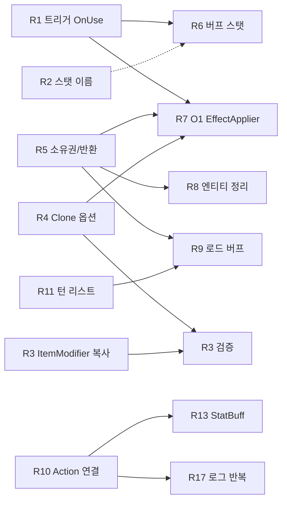

# 모디파이어 남은 작업 목록

- 작성일: 2026-10-23
- 상태: 승인 대기
- 기준: 브랜치 `ClaudeTest`, HEAD `c1fa4528`("MainScene 모디파이어 관련 버그 수정"), 워킹 트리 깨끗함. 줄 번호는 모두 이 시점 기준이다.
- 입력 자료: `docs/refactor/modifier-pool-spec.md`(H/M/L, Q1~Q12), `docs/refactor/review-report.md`(문제 1~6, 남은 점), `docs/refactor/implementation-log.md`, `docs/specs/2026-10-23-modifier-apply-context.md`(15장 O1~O3, 14장 T10~T15)
- 관련 클래스: `Modifier`, `BuffModifier`, `ItemModifier`, `ActionModifier`, `ModifierController`, `ModifierPooler`, `ModifierFactory`, `ModifierDataManager`, `ModifierOption`, `EffectApplier`, `EventManager`, `LivingEntity`, `MonsterEntity`, `MonsterManager`, `ItemBase`, `EquipItem`, `ConsumableItem`, `StatBuff`

---

## 0. 이 문서를 읽는 법

- 문서에 남은 항목을 모두 **현재 코드로 다시 확인**했다. 이미 고쳐진 것은 8장에 "해결됨"으로 따로 모았다.
- 코드를 다시 읽다가 새로 찾은 결함(R1, R2, R4의 일부, R6, R11)도 넣었다. 출처 열에 "신규"로 표시했다.
- 이 문서는 작업 목록이다. 항목마다 방향(안 A/B)만 적고, 구현 명세는 항목을 고른 뒤 따로 쓴다.
- 변경 분류(신규/추가/수정)는 항목마다 적었다. **CSV 데이터 변경도 기존 에셋을 바꾸므로 "수정"으로 분류한다.** "수정"은 9장 체크 후에만 구현한다.
- **그리드 데이터 영향: 모든 항목 없음.** 그리드 좌표, 점유, 시야, 사거리, 이동 판정 코드는 어느 항목도 건드리지 않는다. R8의 몬스터 정리는 기존 `MonsterEntity.Return()`(맵 점유 해제 포함) **앞에** 모디파이어 정리만 끼워 넣는다.
- **인코딩 주의**: 아래 파일은 UTF-8이 아니다(CP949 추정). Edit/Write 도구로 고치면 한글 주석이 깨진다. 셸에서 인코딩을 유지한 채 고치고, 새 주석과 로그 문자열은 영어로 쓴다(`2026-10-23-modifier-apply-context.md` 11장 방법).
  - 레거시: `Modifier.cs`, `ModifierPooler.cs`, `ModifierFactory.cs`, `ModifierDataManager.cs`, `EventManager.cs`, `LivingEntity.cs`, `PlayerEntity.cs`, `MonsterEntity.cs`, `MonsterManager.cs`, `MonsterFactory.cs`, `ItemManager.cs`, `ItemBase.cs`, `ConsumableItem.cs`, `EquipSystem.cs`, `EffectDataManager.cs`, `Defines.cs`, `SelectPanels.cs`, `UI_InventoryConfirm.cs`
  - UTF-8(일반 편집 가능): `ModifierController.cs`, `ModifierOption.cs`, `ModifierManager.cs`, `EffectApplier.cs`, `EquipItem.cs`, `ItemEntity.cs`, `ModifierAction.cs`, `ModifierDataClasses.cs`, 모든 `ModifierDatas/*.csv`

---

## 1. 요약 표

직접 추천: ◎ 직접 하기 좋음(데이터/오타/국소, 설계 판단 거의 없음) · ○ 직접 가능(국소지만 결정 1개 또는 레거시 인코딩) · △ 선행 항목 뒤에만 · - implementer 권장

| ID | 제목 | 심각도 | 난이도 | 사용자 결정 | 직접 추천 | 출처 | 관련 파일:줄 |
|---|---|---|---|---|---|---|---|
| R1 | 트리거 `OnUse`가 enum에 없어 `OnEquip`으로 읽힘 (버프가 장비 변경마다 재등록) | 높음 | 쉬움 | 필요 | ◎ | 신규 | `Mod_BuffModifier.csv:2-21`, `Mod_ItemModifier.csv:14`, `Defines.cs:194-209`, `Utils.cs:139-150` |
| R2 | `StatType`에 없는 스탯 이름(`MagicDamage`, `MagicAccuracy`)이 HP로 읽힘 | 중간 | 쉬움 | 필요 | ◎ | 신규 | `Mod_StatModifier.csv:9,10,39,40`, `Defines.cs:218-254` |
| R3 | `ItemModifier` 베이스 필드 미복사 + `StatType` 열 미판독, Buff/Action `effectName` 미복사 | 높음 | 보통 | 필요 | - | Q7/M3 + 신규 | `Modifier.cs:47-55`, `:504-520`, `:587-594`, `Mod_ItemModifier.csv:1` |
| R4 | `Clone()`이 옵션을 잃음 (주운 아이템, 시작 장비의 옵션이 빔) | 높음 | 보통 | 필요 | - | 검수 문제 5 + 신규 | `ItemBase.cs:57-72`, `ConsumableItem.cs:10-27`, `EquipItem.cs:14-21`, `InventoryData.cs:64-70` |
| R5 | 장비 해제 시 옵션 소유 모디파이어 반환 (H1), Remove 실패해도 반환 | 높음 | 어려움 (안 A는 쉬움) | 필요 | 사용자 처리 예정 (안 A는 ○) | H1, H2(c), 9단계 | `ModifierController.cs:111-117`, `:168-181`, `EquipSystem.cs:27-37` |
| R6 | `BuffModifier`가 스탯을 컨텍스트에 넣지 않음 (스탯 버프 무효) | 높음 | 어려움 | 필요 | - | 신규 | `Modifier.cs:200-294`, `EntityStat.cs:136-181` |
| R7 | `EffectApplier.ApplySynchronized`가 버프 2개 이상일 때만 적용 | 중간 | 쉬움 | 필요 | △ (R4, R5 뒤) | O1 | `EffectApplier.cs:8-26`, `ItemBase.cs:24-33` |
| R8 | 엔티티 정리 경로 부재 (층 이동 몬스터, 풀 재사용 몬스터, `OnDead` 옵션 미반환, `entityBuffs` 잔존) | 중간 | 어려움 | 필요 | - | Q12, 검수 문제 3 + 신규 | `MonsterManager.cs:421-428`, `LivingEntity.cs:316-335`, `ModifierController.cs:413-434`, `EventManager.cs:182-188` |
| R9 | 로드한 몬스터 버프가 컨트롤러에 안 들어감 (만료 시 반환 안 됨), 구 세이브 호환 | 중간 | 보통 | 필요 | - | 검수 남은 점, 문제 4, Q3 | `MonsterManager.cs:372-399`, `ModifierController.cs:168-181` |
| R10 | `Action_*` 30행 베이스 없음 + `ActionModifier.action` 연결 경로 없음 | 중간 | 어려움 | 필요 | - | Q5/M1 잔여 + 신규 | `ModOption_Action.csv:2-31`, `Mod_ActionModifier.csv:2-6`, `Modifier.cs:450-454` |
| R11 | `GetBuffInstance`가 현재 턴 리스트에도 등록 (처리 안 되는 리스트 누적, 지속 0 버프 영구) | 중간 | 쉬움 | 경미 | ○ | 신규 | `EventManager.cs:141-167`, `TurnManager.cs:38-44` |
| R12 | `ReturnModifierOption`에 중복/외부 반환 가드 없음 | 낮음 | 쉬움 | 불필요 | ○ | 검수 문제 2 | `ModifierPooler.cs:199-231` |
| R13 | `StatBuff.Excute` 이중 BuffInstance 등록, 만료 후 `modifier` 참조 유지 (현재 휴면 경로) | 낮음 | 쉬움 | 필요 | ○ | Q11, Q4 | `ModifierAction.cs:99-115` |
| R14 | `ModOption_AddOptions.csv` 헤더 `IsMuti` 오타 | 낮음 | 쉬움 | 불필요 | ◎ | Q9/L5 | `ModOption_AddOptions.csv:1` |
| R15 | `ModOption_JobStat.csv` 헤더 `DescKey` 변경 기록 | 낮음 | 쉬움 | 필요 (유지 확정) | ◎ | 검수 문제 1 | `ModOption_JobStat.csv:1` |
| R16 | `AssembleOption`이 `option.descKey`를 세팅하지 않음 | 낮음 | 쉬움 | 불필요 | ◎ | L6 | `ModifierFactory.cs:76-131`, `ItemEntity.cs:46-62` |
| R17 | 베이스 없는 행을 대여할 때마다 LogError 반복 | 낮음 | 쉬움 | 불필요 | ○ | 검수 문제 6 | `ModifierPooler.cs:124`, `ModifierDataManager.cs:261-272` |
| R18 | 오타 식별자 T10~T15 | 낮음 | 쉬움~보통 | T12/T14/T15 필요 | T10/T13 ○ | 이전 명세 14장 | `ModifierAction.cs:9,33`, `TurnManager.cs:6`, `LivingEntity.cs:126` 등 |
| R19 | 데이터 ID/키 오타 (`Potion_FireRsist`, `Insivible` 등) | 낮음 | 쉬움 | 필요 | ○ | 신규 | `ModOption_Buff.csv`, `ModOption_Action.csv`, `Item_ConsumData.csv` |
| R20 | 런타임 스크립트의 `using UnityEditor*` (플레이어 빌드 차단) | 중간 | 쉬움 | 불필요 | ◎ | L4 잔여 | `MonsterManager.cs:7`, `CombatManager.cs:5` 외 4곳 |

---

## 2. 추천 작업 순서

### 2.1 의존 관계

- R1을 먼저 한다. 버프가 어느 트리거 리스트에 들어가는지가 R6, R7의 동작을 정한다.
- R5(최소 안 A라도)를 R7, R8, R9보다 먼저 한다. 지금은 `RemoveModifierInternal`이 Remove에 실패해도 반환하므로, 버프 적용 경로를 늘리면(R7) 아이템 옵션이 들고 있는 모디파이어가 풀로 돌아간다.
- R4를 R7보다 먼저 한다. 인벤토리 소모품은 지금 옵션이 비어 있어서 R7을 고쳐도 확인할 수가 없다.
- R10이 끝나면 R13과 R17은 자연히 정리되거나 범위가 바뀐다.

### 2.2 단계

1. **데이터·오타 정리 (직접, 동작 변화 없음)**: R14, R15, R20. 컴파일 확인만 하면 된다.
2. **데이터 정정 (직접, 결정 후, 동작 변화 있음)**: R1(안 A), R2(안 A), R19. 결정 사항은 각 항목 참조.
3. **국소 코드 (직접 가능)**: R12, R11, R16, R17, R5 안 A.
4. **기능 복구 (implementer)**: R4 → R3 → R7.
5. **설계 결정 필요 (implementer, 별도 명세)**: R6, R8, R9, R10, R13, R5 안 B.
6. **선택**: R18.

---

## 3. 데이터 계열 항목

### R1. 트리거 `OnUse`가 enum에 없어 `OnEquip`으로 읽힘

- 분류: 수정(CSV) / 안 B는 수정(코드)
- 현재 동작
  - `Mod_BuffModifier.csv:2-21`의 `ModifierTrigger`가 모두 `OnUse`다. `Mod_ItemModifier.csv:14`(`Potion_Effect`)도 `OnUse`다.
  - `ModifierTriggerType`에는 `OnUse`가 없고 `OnUseItem`만 있다(`Defines.cs:194-209`).
  - `Modifier.SetBaseData`(`Modifier.cs:106`)가 `Utils.TryConvertEnum(originData, "ModifierTrigger", ref triggerType)`를 부른다. `TryConvertEnum`은 `Enum.TryParse(..., out target)`이라(`Utils.cs:143`) 실패하면 `target`이 `default`(= `OnEquip`, 0)로 **덮어써진다.** 경고도 없다.
  - 그래서 버프 베이스 20개와 `Potion_Effect`의 `triggerType`은 모두 `OnEquip`이다.
- 문제
  - `LivingEntity.Add_Buff`(`LivingEntity.cs:78-89`)로 들어온 버프는 컨트롤러 `buffs[OnEquip]`에 들어간다.
  - 장비를 바꿀 때마다 `OnChangeEquipment`(`ModifierController.cs:82-86`) → `GetUpdatedContext(OnEquip)` → `BuffModifier.Apply(entity)`(`Modifier.cs:214-220`) → `EventManager.AddBuff`가 다시 불린다. **장비 변경 1회마다 BuffInstance가 1개씩 늘어난다.**
  - 늘어난 인스턴스가 만료될 때마다 `Remove_BuffModifier`가 불린다. 첫 번째만 리스트에서 빠지고, 나머지는 Remove에 실패해도 `Return_Modifier`까지 간다(R5). 그사이 같은 객체가 다른 소유자에게 재대여됐다면 **남의 모디파이어를 반환한다.**
  - `Potion_Effect`(StoneBorn 종족의 포션 효과 -10%)는 `OnUseItem`이 아니라 `OnEquip` 리스트에 들어가서, `ItemSelectPanel.cs:139`의 `IsRestricted(…, OnUseItem)`에서 보이지 않는다.
- 수정 방향
  - **안 A (추천, 데이터만)**: `Mod_BuffModifier.csv` 20행과 `Mod_ItemModifier.csv:14`의 `OnUse`를 `OnUseItem`으로 바꾼다. `ModOption_Action.csv`의 28곳은 열 이름이 `ModifeirTrigger`(오타)라서 코드가 읽지 않는다. 맞춰 두려면 같이 바꾸되 동작에는 영향이 없다.
  - 안 B: `ModifierTriggerType` 끝에 `OnUse`를 추가한다. 끝에 붙이면 기존 정수값은 그대로다. 다만 `OnUse`와 `OnUseItem`의 의미가 겹쳐 혼란이 생긴다.
  - 선택(공통, 수정): `TryConvertEnum`/`StringToEnum`이 실패할 때 `LogWarning`을 한 번 남기게 한다. 같은 원인으로 R2가 숨어 있었다. 단, 실패 시 `default`로 덮어쓰는 동작 자체를 바꾸면 다른 데이터 로드에도 영향이 가므로 경고만 추가한다.
- 영향 범위
  - 안 A 이후 버프는 `buffs[OnUseItem]`에 들어간다. `GetUpdatedContext(OnUseItem)`을 부르는 곳은 현재 없다(`OnUseItem` 사용처: `ItemBase.cs:32`의 `ExecuteAction`은 빈 메서드, `PlayerEntity.cs:263`은 행동력 계산만). 그래서 장비 변경 때 버프 재등록이 사라진다.
  - `Potion_Effect`가 `IsRestricted(…, OnUseItem)`과 `ItemModifier` 적용 대상에 새로 잡힌다. 단, `ItemModifier` 필드 복사 문제(R3) 때문에 지금은 실제 판정이 기본값으로 돈다.
- 확인 방법
  1. 버프 포션을 사용한다(R7 전에는 버프 2개짜리 포션, 예: `Potion_Warrior`).
  2. 장비를 3번 바꾼다.
  3. 만료 턴까지 진행한 뒤 콘솔에 `duplicate return ignored`/`duplicate or foreign return ignored` 경고가 없는지, `Buff Removed from` 로그가 버프 수만큼만 찍히는지 본다.
  4. 세이브 JSON의 몬스터 `buffs` 개수가 늘지 않는지 본다.
- 결정 필요
  - 안 A(CSV) / 안 B(enum 추가) 중 무엇으로 할지.
  - `ModOption_Action.csv`의 `ModifeirTrigger` 열 이름과 값도 함께 정리할지.

### R2. `StatType`에 없는 스탯 이름이 HP로 읽힘

- 분류: 수정(CSV) / 안 B는 수정(코드)
- 현재 동작
  - `Mod_StatModifier.csv:9`(`Weapon_MagicDamage`), `:10`(`Weapon_MagicAccuracy`), `:39`(`Race_MagicDamage`), `:40`(`Race_MagicAccuracy`)의 `StringValue`가 `MagicDamage`/`MagicAccuracy`다.
  - `StatType`에는 이 이름이 없고 `SpellDamage`, `SpellAccurancy`(철자 그대로)가 있다(`Defines.cs:234-235`).
  - `StatModifier.SetBaseData`와 `Set_BaseModData`(`Modifier.cs:188-197`)의 변환이 실패하면 R1과 같은 이유로 `stat`이 `default`(= `HP`)가 된다.
- 문제: 이 베이스를 쓰는 밸류 행이 HP를 바꾼다.
  - `ModOption_StartStat.csv:5-6`(엘프 +1, +1), `:20`(SpellBane -1), `ModOption_Stat.csv:17-18`(`Kris` 무기 +2, -0.1).
  - Passive 컨텍스트의 `stats[HP]`에 더해져 `EntityStat.CalculateContext`의 최종 HP 계산(`EntityStat.cs:150-157`)에 들어간다.
- 수정 방향
  - **안 A (추천, 데이터만)**: `StringValue`를 `SpellDamage`/`SpellAccurancy`로 바꾼다. 4행.
  - 안 B: `StatType` 끝에 `MagicDamage`, `MagicAccuracy`를 추가한다. 이 스탯을 읽는 전투 코드가 없으므로 따로 연결해야 한다.
  - 참고: `Race_MaxHp`(`MaxHp`), `Level_Str`(`STr`)는 대소문자를 무시하는 파싱이라 정상이다.
- 영향 범위: 엘프, SpellBane 종족 시작 HP와 `Kris` 무기의 HP가 바뀐다(정상화).
- 확인 방법: 엘프로 시작해 스탯 UI의 HP와 MaxHP가 종족 HP 보정 없이 기본값인지 본다. 종족 선택 화면 프리뷰도 같이 본다.
- 결정 필요: 마법 공격/명중을 `Spell*` 스탯으로 볼지(안 A), 별도 스탯을 만들지(안 B).

### R14. `ModOption_AddOptions.csv` 헤더 `IsMuti` 오타 (Q9)

- 분류: 수정(CSV, 동작 변화 없음)
- 현재 동작: 헤더가 `IsMuti`(`ModOption_AddOptions.csv:1`)라서 `ModifierValueData.ParseFromCsv`가 `IsMulti`를 못 읽는다(`ModifierDataClasses.cs:33`, `hasIsMulti = false`). 그래서 베이스의 `isMulti`가 쓰인다.
- 확인 결과: 84행 전부의 `IsMuti` 값이 해당 베이스의 `IsMulti`와 같다. `FALSE` 행은 `Weapon_Damage`/`Weapon_Accuracy`/`AddOption_Str` 등 FALSE 베이스, `TRUE` 5행(`:30,31,83-85`)은 `AddOption_AttackSpeed`(TRUE), `AddOption_Vamp`(TRUE), `AddOption_ElementalDamage_*`(TRUE) 베이스다. **헤더를 고쳐도 수치는 같다.**
- 수정 방향: 1행의 `IsMuti`를 `IsMulti`로 바꾼다. 다른 바이트는 건드리지 않는다(줄바꿈, BOM 유지).
- 영향 범위: `RandomOptionManager.cs:64`도 `IsMulti`를 읽지만 `RandomOptionManager.SetUp`이 주석 처리돼 있어(`DataManager.cs:113`) 지금은 영향이 없다.
- 확인 방법: 데이터 로드 로그에 에러가 없고, 무기 툴팁의 추가 옵션 수치가 이전과 같다.
- 결정 필요: 없음.

### R15. `ModOption_JobStat.csv` 헤더 `DescKey` 변경 기록 (검수 문제 1)

- 분류: 기록만(이미 반영된 데이터 변경의 확정)
- 현재 상태: 1행 헤더가 `DescKey`다(검수 당시 승인 목록 밖 변경). 지금은 파일 전체가 CRLF로 통일돼 있어 검수 때 지적한 줄바꿈 혼재는 없다.
- 영향: JobStat 행의 `descKey`가 채워진다. `Modifier.descKey`를 읽는 UI가 없어서 화면 변화는 없다.
- 수정 방향: 유지하기로 하면 `docs/refactor/implementation-log.md`의 "CSV spelling fixes"에 한 줄 추가한다. 되돌리기로 하면 헤더를 `DeskKey`로 되돌린다.
- 확인 방법: 없음(문서 정리).
- 결정 필요: 유지 / 되돌리기.

### R19. 데이터 ID/키 오타

- 분류: 수정(CSV)
- 현재 상태(동작에는 문제 없음, 키끼리 서로 맞춰져 있음)
  - OptionKey/밸류 ID: `Potion_FireRsist`(`ModOption_Buff.csv:14-15`), `Potion_AgillityBuff`(`:5`), `Potion_VamfierBlood`(`:23-24`), `Potion_Ranodm`(`ModOption_Action.csv:6`). 일부는 `Item_ConsumData.csv`에서 참조한다(4곳).
  - 베이스 ID: `Action_MpHeaing`, `Action_WeaponAccurcy`(`ModOption_Action.csv:5,20`, 베이스 자체가 없음, R10).
  - EffectName: `Insivible`(`Mod_BuffModifier.csv:11`).
  - OptionName: `Add_D_MagiacResist`(`ModOption_AddOptions.csv:80-82`).
  - 기타: `Mod_BuffModifier.csv`의 `StringKey` 열은 코드가 읽지 않는다(코드는 `StringValue`를 읽음, `Modifier.cs:109`). 값 `LifeSeal`, `Teleport`도 옛 철자다.
- 문제: 지금은 키가 서로 맞아서 동작한다. 한쪽만 고치면 옵션이 조립되지 않는다.
- 수정 방향: 고칠 키마다 `Assets` 전체(`*.csv`, `*.json`, `*.asset`)를 검색해 모든 참조를 같이 바꾼다. 세이브 파일에 OptionKey가 저장되므로(`ModifierOption.SaveData`) 기존 세이브의 해당 옵션은 로드되지 않는다.
- 확인 방법: 데이터 로드 로그의 `value rows without base modifier` 개수가 바뀌지 않는지, 해당 포션이 조립되는지(`[ModifierFactory] ... 없습니다` 경고 없음) 본다.
- 결정 필요: 고칠지 여부. 고친다면 세이브 호환을 포기해도 되는지(R9와 같은 질문).

---

## 4. 국소 코드 항목

### R11. `GetBuffInstance`가 현재 턴 리스트에도 등록

- 분류: 수정
- 현재 동작
  - `EventManager.GetBuffInstance`(`EventManager.cs:141-167`)가 꺼낸 인스턴스를 `activeBuffs[Turn]`(현재 턴)에 넣는다(`:155-165`).
  - 이어서 `AddBuff`가 같은 인스턴스를 `activeBuffs[endTurn]`에 또 넣는다(`:72-82`).
  - 턴 처리는 `ProcessPassedTurn(LastTurn+1, GlovalTurn)`(`TurnManager.cs:43`)이라 현재 턴 키는 다시 처리되지 않는다.
- 문제
  - `activeBuffs[현재 턴]` 리스트가 처리되지 않고 계속 쌓인다. 반환된 인스턴스가 재사용돼도 옛 리스트에 참조가 남는다.
  - `duration == 0`이면 `endTurn == Turn`이라 그 버프는 **영원히 만료되지 않는다.** 로드한 버프의 `leftDuration`이 0 이하일 때도 같다(R9).
- 수정 방향: `GetBuffInstance`의 `:155-165` 등록을 지운다. `AddBuff`에서 `duration`을 최소 1로 보정한다.
- 영향 범위: 정상 버프(min 1턴 이상)의 만료 시점은 같다. 지속 0 버프는 다음 턴에 만료된다.
- 확인 방법: 버프 포션 사용 → 만료 턴 진행 → `Buff Removed` 로그가 1번 찍히는지. 세이브 직후 바로 로드(leftDuration 0 근처)한 몬스터 버프가 다음 턴에 풀리는지.
- 결정 필요: 지속 0을 "다음 턴 만료"로 볼지, "즉시 무시"로 볼지.

### R12. `ReturnModifierOption` 중복/외부 반환 가드 (검수 문제 2)

- 분류: 수정
- 현재 동작: `ModifierPooler.ReturnModifierOption`(`ModifierPooler.cs:199-231`)은 active 리스트에서 빠졌는지 확인하지 않고 Enqueue한다. 모디파이어 반환(`:233-270`)에는 `isInPool`과 active `Remove` 검사가 있다.
- 문제: 같은 옵션이 두 번 반환되면 두 소유자에게 같은 옵션이 나가고, `AssembleOption`의 `myMods.Clear()`(`ModifierFactory.cs:110`)가 다른 소유자의 모디파이어를 지운다. 지금 이중 반환 경로는 발견되지 않았지만 R4, R8에서 옵션 반환 경로가 늘어난다.
- 수정 방향: 메서드 맨 앞에서 `activeModifierOptions[id].Remove(script)`가 false면 경고 후 return한다(**모디파이어 연쇄 반환보다 먼저**). 선택: `ModifierOption`에 `isInPool` 플래그.
- 확인 방법: 종족/직업을 10번 바꾸고 UI를 닫았다 연다(`SelectPanels.cs:111-115`, `:282-286`). 경고가 없어야 한다. `DumpStats()`에 `INVARIANT BROKEN`이 없어야 한다.
- 결정 필요: 없음.

### R16. `AssembleOption`이 `option.descKey`를 세팅하지 않음 (L6)

- 분류: 수정
- 현재 동작: `ModifierGroupData.descKey`는 읽지만(`ModifierDataClasses.cs:55`) `AssembleOption`(`ModifierFactory.cs:76-131`)이 옵션에 옮기지 않는다. `ItemEntity.ViewingOptions`(`ItemEntity.cs:46-62`)가 이 값을 디버그 리스트에 넣어서 null만 쌓인다.
- 수정 방향: `optionData`를 얻은 직후 `option.descKey = optionData.descKey;` 한 줄. 풀에서 재사용되는 옵션도 매번 덮어쓴다.
- 함께 볼 것(선택): `ItemEntity.ResetData`(`:30-33`)가 `myModifiers`/`myAddOptions`를 비우지 않아 재사용할 때 계속 쌓인다(인스펙터 디버그용).
- 확인 방법: 필드 아이템을 인스펙터로 보면 `myModifiers`에 문자열 키가 보인다.
- 결정 필요: 없음.

### R17. 베이스 없는 행 대여 시 LogError 반복 (검수 문제 6)

- 분류: 수정
- 현재 동작: `RentBase`(`ModifierPooler.cs:124`)가 매번 `Get_ModifierBase`를 부르고, 없으면 LogError를 낸다(`ModifierDataManager.cs:269`). `Action_*` 30행이 든 포션/스크롤이 조립될 때마다 반복된다. 로드 때 `ValidateValueBases`가 이미 한 번 묶어서 경고한다.
- 수정 방향: `RentBase`에서 `HasModifierBase`로 먼저 걸러 조용히 null을 돌려준다. 또는 실패한 baseID를 `HashSet`에 기록해 처음 한 번만 로그한다.
- 의존: R10에서 Action 베이스가 생기면 이 로그는 자연히 사라진다.
- 확인 방법: 같은 층을 2번 생성할 때 같은 LogError가 반복되지 않는다.
- 결정 필요: 없음.

### R13. `StatBuff.Excute` 이중 등록, 만료 후 참조 유지 (Q11, Q4)

- 분류: 수정
- 현재 동작
  - `StatBuff.Excute`(`ModifierAction.cs:107-115`)가 `target.Add_Buff(modifier)`와 `EventManager.instance.AddBuff(...)`를 둘 다 부른다. `Add_Buff`가 이미 `EventManager.AddBuff`를 부르므로(`LivingEntity.cs:82-86`) BuffInstance가 2개 생긴다.
  - `GetMyModifier`(`:99-106`)는 `modifier == null`일 때만 대여한다. 만료로 풀에 돌아간 뒤에도 필드가 남아 재실행 때 반환된 객체를 다시 쓴다.
  - `RentBaseOnly(effectID)`는 밸류 주입이 없다(Q4). `EffectDataManager.CopyEffect`(`EffectDataManager.cs:197-202`)도 같다.
- 현재 도달 여부: **휴면 경로다.** `StatBuff`는 `EffectDataManager.SetEffects`가 `ActionData` 에셋을 읽을 때만 만들어지는데 `Assets/Resources_moved/StringDatas/ActionDatas/` 폴더에 파일이 없다. `EffectManager.GetActionEffectScript`(`EffectManager.cs:37-61`)도 호출부가 없다.
- 구분: O3(`Add_Buff` 안의 EventManager + 컨트롤러 이중 호출)은 사용자가 의도된 동작이라고 했다. 이 항목은 그 바깥에서 `EventManager.AddBuff`를 **한 번 더** 부르는 줄이다.
- 수정 방향: `:114`의 `EventManager.instance.AddBuff(...)` 줄을 지운다. 만료 처리 때 `modifier = null`로 되돌린다(만료 콜백 연결은 R10 설계와 함께).
- 확인 방법: R10으로 경로가 살아난 뒤 `StatBuff` 효과 1회 → `Get_EntityBuffList(target).Count == 1`.
- 결정 필요: `:114`가 의도된 것인지. Q4(effectID가 어떤 ID인가)는 R10 설계에서 답한다.

### R20. 런타임 스크립트의 `using UnityEditor*`

- 분류: 수정(동작 변화 없음)
- 현재 상태: `Modifier.cs`의 것은 이전 명세(M8)로 지웠다. 남은 곳은 다음과 같다.
  - `MonsterManager.cs:7` `using UnityEditor.EditorTools;`
  - `CombatManager.cs:5` `using UnityEditor.Experimental.GraphView;`
  - `RaceData.cs:5` `using UnityEditorInternal.VersionControl;`
  - `StringKeyManager.cs:6` `using UnityEditor.VersionControl;`
  - `Input_Player.cs:2` `using UnityEditor.ShaderGraph;`
  - `MapManager.cs:7` `using UnityEditor;` (`:1042-1049`의 `#if UNITY_EDITOR` 안에서 `Handles.Label`을 쓴다)
- 문제: 에디터에서는 컴파일되지만 플레이어 빌드에서 `UnityEditor` 어셈블리가 없어 컴파일 에러가 난다.
- 수정 방향: 앞의 5곳은 지운다(지운 뒤 컴파일로 사용처가 없는지 확인). `MapManager.cs`는 지우지 말고 `#if UNITY_EDITOR` / `#endif`로 감싼다.
- 확인 방법: 에디터 Console 에러 0건 → Development Build 1회.
- 결정 필요: 없음.

---

## 5. 기능 복구 항목 (implementer 권장)

### R3. `ItemModifier` 베이스 필드 미복사 + `StatType` 열 미판독 (Q7/M3)

- 분류: 수정(코드 + CSV)
- 현재 동작
  - `Set_BaseModData`(`Modifier.cs:47-55`)는 공통 필드만 복사한다. `ItemModifier`에는 override가 없다.
  - 풀에서 나온 `ItemModifier`는 `Reset`(`:587-594`) 값 그대로다. `itemTargetType = Category`, `itemCategory = Consumable`, `specificType = null`.
  - `ItemModifier.SetBaseData`(`:504-520`)는 `Mod_ItemModifier.csv`의 `StatType` 열을 **읽지 않는다.** 그래서 템플릿의 `stat`도 기본값(`HP`)이다. 데이터에는 `Deffense` 오타도 있다(`Mod_ItemModifier.csv:2,9`).
  - Buff/Action의 `effectName`도 템플릿(`:289-293`, `:479-483`)에만 있고 복사되지 않는다. `ActionModifier.Apply`의 중복 판정(`:391`)이 이 값을 비교한다.
- 문제
  - 종족 장비 보너스(`ModOption_Item.csv` 23행 전부)가 장비에 맞지 않는다. 판정 대상이 늘 "소모품 전체"이고, 맞더라도 HP를 바꾼다.
  - `IsRestricted`(`ModifierController.cs:290-348`)도 같은 기본값으로 판정한다. 시작 아이템 선택 화면(`ItemSelectPanel.cs:126-139`)의 제한 결과가 데이터와 다르다.
- 수정 방향
  1. `ItemModifier.Set_BaseModData` override 추가: `itemTargetType`, `itemCategory`, `specificType`, `Equipable`, `stat` 복사.
  2. `ItemModifier.SetBaseData`에서 `StatType` 열을 `TryConvertEnum`으로 읽는다. CSV `Deffense` → `Defense`.
  3. `BuffModifier`/`ActionModifier`의 `Set_BaseModData` override에서 `effectName` 복사.
  4. `DamageModifier`의 `damageType`/`evokeRate`는 베이스 데이터 파일이 없어 이번에는 다루지 않는다.
- 남는 설계 문제(결정 필요)
  - `ItemModifier.Apply`는 `entity.usingItem`으로 판정한다(`Modifier.cs:528-553`). `usingItem`은 `LivingEntity.UseItem` 안에서만 잠깐 세팅된다(`LivingEntity.cs:128-141`). 장착 직후 계산에서는 맞지만, 나중에 OnEquip 컨텍스트가 다시 계산되면(dirty → `Clear` 후 재적용) `usingItem`이 null이라 보너스가 **빠진다.**
  - 안 A: 판정 대상을 "현재 장착 중인 장비 목록"으로 바꾼다(`EquipSystem` 조회). 안 B: `usingItem` 판정은 사용 순간 전용(OnUseItem)으로만 두고, 장비 보너스는 장착 시 별도 StatModifier로 등록한다.
- 영향 범위: 종족 장비 보너스가 처음으로 실제 적용된다(수치 변화가 정상). 시작 아이템 제한 목록이 바뀔 수 있다.
- 확인 방법
  1. 엘프로 시작해 장검(LongSword)을 장착한다.
  2. Damage가 +1, 배율 +10%, Accuracy +1 되는지 본다.
  3. 해제 후 원래 값으로 돌아오는지, 피격 등으로 컨텍스트가 다시 계산된 뒤에도 보너스가 유지되는지 본다.
  4. 종족 선택 화면에서 시작 아이템 목록이 데이터 의도와 같은지 본다.
  - R4가 안 되면 시작 장비에 옵션이 없으므로, R4 이후에 확인한다.
- 결정 필요: Q7 승인(동작 변화), 위 안 A/B.

### R4. `Clone()`이 옵션을 잃음 (검수 문제 5)

- 분류: 수정
- 현재 동작
  - 줍기와 시작 아이템 지급은 모두 `InventoryData.AddInventory` → `item.Clone()`(`InventoryData.cs:64-70`)을 거친다.
  - `ConsumableItem.Clone`(`ConsumableItem.cs:10-27`): `ItemMake`로 새 아이템(옵션 대여됨) → `ReleaseOptions()`로 반환 → `CopyBaseProperties`가 `options`를 빈 리스트로 만든다(`ItemBase.cs:71`). 결과: 옵션 없음.
  - `EquipItem.Clone`(`EquipItem.cs:14-21`): `ItemMake`가 대여한 옵션을 `CopyBaseProperties`가 덮어써 잃어버린다(누수). 원본의 `addOptions`, `rarity`, `equipCategory`, `itemSubType`도 옮기지 않는다.
  - 원본(바닥 아이템)은 `ItemEntity.Return()`에서 `item = null`이 되고(`ItemEntity.cs:63-70`) 옵션은 반환되지 않는다(누수).
  - `ConsumableItem.cs:18`의 `newConsum.options.OfType<ActionModifier>()`는 `List<ModifierOption>`에 대한 것이라 항상 비어 있다. `SetConsumableFlag`가 한 번도 불리지 않는다.
- 문제: 인벤토리의 포션/스크롤/장비가 효과를 내지 못한다. 시작 장비(`SelectPanels.cs:239-243`)도 옵션이 없다. 매 줍기마다 옵션이 샌다.
- 수정 방향
  - **안 A (소유권 이동)**: `Clone`이 원본의 `options`/`addOptions` 리스트 내용을 새 객체로 옮기고 원본 리스트는 비운다. `ItemMake`로 새로 대여하지 않는다(또는 대여분은 즉시 반환). 아이템은 한 곳에만 있으므로 맞는 모델이다.
  - 안 B (새로 조립): `optionKeys`로 옵션을 새로 대여하고, `addOptions`만 원본에서 옮긴다. 원본 `options`는 반환한다.
  - 공통: `OfType<ActionModifier>()`를 `options[i].myMods`를 도는 루프로 바꾼다. `rarity` 등 누락 필드 복사.
- 영향 범위: 인벤토리 아이템이 처음으로 옵션을 가진다. 장착/사용 시 수치가 바뀌는 것이 정상이다. 세이브(`EquipItem.SaveData`)의 `addOptionsData`가 채워진다.
- 확인 방법
  1. 바닥의 추가 옵션 장비를 주워 인벤토리 툴팁 수치가 바닥에서 본 것과 같은지 본다.
  2. 포션을 주워 사용한다(R7 이후 단일 버프도 확인).
  3. 같은 층 5회 왕복 후 `DumpStats()`에서 옵션/모디파이어 active 수가 늘지 않는지 본다.
- 결정 필요: 안 A/B. 소모품이 스택으로 합쳐질 때(같은 이름 2개 줍기) 두 번째 아이템의 옵션을 반환할지.

### R7. `EffectApplier`가 버프 2개 이상일 때만 적용 (O1)

- 분류: 수정
- 현재 동작: `ApplySynchronized`(`EffectApplier.cs:8-26`)는 `BuffModifier`가 2개 이상일 때만 지속시간을 맞추고 **적용 루프도 그 안에서만** 돈다. 그래서 버프 1개짜리(`Potion_StrengthBuff` 등 대부분)와 버프가 없는 옵션은 아무 효과가 없다. 호출부는 `ItemBase.OnUse`(`ItemBase.cs:24-33`) 하나다.
- 수정 방향
  - **안 A**: 동기화만 `if (buffs.Count > 1)` 안에 두고, 적용 루프는 항상 돈다.
  - 안 B: 안 A + 버프 1개일 때도 `duration`을 미리 굴려 둔다(동작은 같다. `BuffModifier.Apply`가 0이면 직접 굴림).
- 의존과 위험
  - R5 안 A가 먼저 필요하다. 소모품 옵션의 모디파이어가 `EventManager`에 등록된 뒤 만료되면 `Remove_BuffModifier` → `RemoveModifierInternal`로 간다. 컨트롤러 `buffs`에 그 트리거 키가 있으면 Remove에 실패해도 **아이템 옵션 소유 객체를 풀에 반환한다**(`ModifierController.cs:170-180`).
  - R4가 먼저 필요하다. 지금은 인벤토리 소모품의 옵션이 비어 있다.
  - 같은 아이템 객체를 여러 번 쓰면 같은 모디파이어가 `EventManager`에 여러 번 등록된다. 소모품 수량 감소가 없어서(`UI_InventoryConfirm.cs:106-119`) 무한히 쓸 수 있다(범위 밖, 10장).
- 확인 방법: 버프 1개 포션 사용 → 버프 로그 1회 → 만료 턴에 해제 로그 1회 → 풀 경고 없음. 버프 2개 포션은 두 버프의 만료 턴이 같은지 본다.
- 결정 필요: 버프 없는 옵션(StatModifier 등)도 사용 시 `Apply(entity)`로 적용할지. 적용하면 엔티티 컨텍스트에 영구히 더해지는지 확인이 필요하다.

---

## 6. 설계 결정 필요 항목 (별도 명세 권장)

### R5. 장비 해제 시 옵션 소유 모디파이어 반환 (H1), Remove 실패해도 반환

- 분류: 수정
- 상태: **사용자가 직접 처리하기로 한 보류 항목**(구현 로그 Step 6). 여기에는 현재 상태와 최소 안만 적는다.
- 현재 동작
  - `EquipSystem.UnEquipItem`(`EquipSystem.cs:27-37`) → `RemoveEquipment(option)` → `RemoveModifierOptionInternal`(`ModifierController.cs:111-117`) → `RemoveModifierInternal`(`:168-181`)이 옵션 안 모디파이어를 풀에 반환한다. 옵션의 `myMods`는 계속 그 객체를 가리킨다.
  - `RemoveModifierInternal`은 `targetDict[trigger].Remove(modifier)`가 실패해도 `OnModifierChanged`와 `Return_Modifier`를 부른다(`:174-180`).
  - 그래서 바닥에 떨어진 장비는 정리 때 반환하지 않는다(`ItemManager.cs:314-320`, 9단계 미완).
- 문제: 재장착 시 다른 밸류 값이 적용되거나 0이 된다. 툴팁 수치가 바뀐다. 중복 반환은 풀 가드로 막히지만, 재대여된 뒤의 반환은 막지 못한다.
- 수정 방향
  - **안 A (최소, 국소)**: `Remove`가 true일 때만 dirty 처리, `OnModifierChanged`, `Return_Modifier`를 한다. H1 자체는 남지만 R1/R7/R9의 "남의 객체 반환"을 막는다. 직접 하기 좋다(`ModifierController.cs`는 UTF-8).
  - 안 B (스펙 6단계): `RemoveModifierInternal(…, bool returnToPool)`. 옵션 경유 제거는 `false`(옵션이 소유), 단독 모디파이어 제거만 `true`. 이후 `ItemManager.ReturnAllObjects`에서 장비도 `ReleaseOptions()`.
- 확인 방법: 장착 → 해제 → 다른 같은 베이스 무기 생성 → 재장착. 수치가 처음과 같은지, 툴팁이 바뀌지 않는지 본다(스펙 8.2 시나리오 2, 3).
- 결정 필요: 안 A만 먼저 할지, 안 B까지 할지(Q2).

### R6. `BuffModifier`가 스탯을 컨텍스트에 넣지 않음

- 분류: 수정(설계)
- 현재 동작
  - `BuffModifier.Apply(LivingEntity)`(`Modifier.cs:214-220`)는 `EventManager.AddBuff`로 만료 예약만 한다. `stats`/`multiplier`에 값을 더하지 않는다.
  - `BuffModifier`에는 `stat` 파싱이 없다(`StatModifier`만 `Modifier.cs:188-197`에서 파싱). `ModOption_Buff.csv`의 `StringValue`(Str, Dex, Regen, Ev 등)는 `stringValue`에만 들어간다.
  - `EntityStat.CalculateContext`(`EntityStat.cs:136-181`)는 Passive 컨텍스트와 요청 트리거 컨텍스트만 더한다.
- 문제: `BuffType = StatBuff` 버프(힘 포션, 신속 포션 등 21행)가 수치에 아무 영향이 없다. 만료 예약과 해제 로그만 돈다.
- 수정 방향
  - 안 A: `BuffModifier`가 `buffType == StatBuff`일 때 `stringValue`를 `StatType`으로 파싱해 `Apply(ModifierContext)`에서 값을 더한다. 등록(`EventManager.AddBuff`)은 `Apply`에서 빼고 `Add_Buff`/`EffectApplier`에서만 한다. 버프 트리거는 스탯 계산에 들어가도록 `Passive`로 둔다.
  - 안 B: 버프 적용 시 같은 스탯의 `StatModifier`를 따로 대여해 `buffs`에 넣고, BuffInstance 만료 때 함께 제거·반환한다.
- 데이터 정리(함께 필요): `ModOption_Buff.csv`의 `Regen`은 `StatType.Regeneration`, `Ev`는 `Evasion`이 맞다. `Invisible`은 스탯이 아니다(ActionBuff로 분류).
- 의존: R1(트리거), R5(반환 규칙). `Apply`가 등록까지 하면 컨텍스트 재계산마다 등록이 반복되므로 R1 문제가 다시 생긴다.
- 확인 방법: 힘 포션 사용 → Str이 +3 → 다른 컨텍스트 재계산(피격, 장비 변경) 후에도 +3 유지 → 만료 턴에 원래 값.
- 결정 필요: 안 A/B, 스탯 버프의 트리거, 중첩 규칙(같은 포션 2번).

### R8. 엔티티 정리 경로 부재 (Q12, 검수 문제 3)

- 분류: 추가(정리 메서드) + 수정(호출부, `ResetData`)
- 현재 동작
  - 층 이동: `DungeonManager.ReturnAllObjects` → `MonsterManager.ReturnAllObjects`(`MonsterManager.cs:421-428`) → `MonsterEntity.Return()`(`MonsterEntity.cs:268-273`). `OnDead`를 거치지 않아 mutation/buff 모디파이어와 옵션이 반환되지 않는다.
  - `EventManager.RemoveEntity`(`EventManager.cs:182-188`)는 죽은 엔티티만 `entityBuffs`에서 뺀다. 층 이동으로 사라진 몬스터의 BuffInstance는 남고, 만료 턴에 `removalAction`이 풀로 돌아간 몬스터 객체에 대해 실행된다.
  - 풀 재사용: `MonsterFactory.GetMonster`(`MonsterFactory.cs:61-70`)가 `ResetData()`를 부르는데 `LivingEntity.ResetData`(`LivingEntity.cs:316-335`)는 `OnModifierChanged` 구독을 **해제만** 하고 컨트롤러는 비우지 않는다. 재구독은 `Init`(`:298-300`, Awake에서 1회)뿐이다. 그래서 재사용된 몬스터는 모디파이어가 바뀌어도 스탯 dirty가 서지 않고, 이전 몬스터의 변이/`mutationOptions`가 남는다.
  - `LoadMonster`(`MonsterManager.cs:326`)는 풀에서 꺼낸 뒤 `ResetData`도 부르지 않는다.
  - `ModifierController.OnDead`(`ModifierController.cs:413-434`)는 리스트 안 모디파이어를 하나씩 반환하고 `mutationOptions.Clear()`만 한다. 옵션 객체는 `activeModifierOptions`에 남는다(누수). 장비 옵션은 반환하지 않는다(주석).
  - `mutationOptions`의 키가 optionKey라서(`:138-146`, `:155-162`) 같은 키의 다른 옵션 객체는 등록되지 않고, `RemoveMutate`는 객체가 달라도 키로 지운다.
- 수정 방향
  1. [추가] `ModifierController.ReleaseAll()`: 옵션 소유 모디파이어는 `Return_ModifierOption`으로 옵션째 반환, 단독 모디파이어(버프)는 객체당 1번 반환, 리스트/사전/컨텍스트/dirty 초기화.
  2. [추가] `EventManager.RemoveEntityBuffs(LivingEntity)`: `entityBuffs`에서 빼고 남은 BuffInstance의 `target`을 null로 둔다(`CheckAndRemoveBuff`가 이미 null 타깃을 건너뜀, `:108-111`).
  3. [수정] `MonsterManager.ReturnAllObjects`에서 `Return()` 전에 1, 2를 부른다. `OnDead`도 1, 2를 쓰도록 바꾼다.
  4. [수정] `LivingEntity.ResetData`에서 컨트롤러 정리 후 `OnModifierChanged`를 다시 구독한다(또는 해제하지 않는다). `LoadMonster`도 `ResetData`를 거치게 한다.
  5. `mutationOptions` 키: 안 A 객체 참조(`List<ModifierOption>`), 안 B optionKey 유지 + 중복 키 경고.
- 의존: R5(옵션 소유 규칙)가 정해져야 1번의 반환 범위가 정해진다. R12(옵션 반환 가드) 권장.
- 확인 방법: 버프가 걸린 몬스터가 있는 층을 5번 왕복 → `DumpStats()`의 `Buff_*`/종족 베이스 active 수가 늘지 않음 → 이전 층 버프 만료 턴에 `Buff Removed` 로그가 찍히지 않음 → 새 층 몬스터의 스탯이 기본값.
- 결정 필요: 몬스터 장비/인벤토리 아이템도 이때 반환할지, `mutationOptions` 키(안 A/B), `OnDead`에서 장비 옵션 처리.

### R9. 로드한 몬스터 버프가 컨트롤러에 안 들어감, 구 세이브 호환 (Q3, 검수 문제 4)

- 분류: 추가(로드용 메서드) + 수정(호출부)
- 현재 동작
  - `LoadMonster`의 버프 복원(`MonsterManager.cs:372-399`)은 `EventManager.AddBuff`만 부른다. 컨트롤러 `buffs`에는 넣지 않는다(검수 남은 점).
  - 만료 때 `Remove_BuffModifier` → `RemoveModifierInternal`에서 트리거 키가 없으면 바로 return한다(`ModifierController.cs:170`). **대여한 모디파이어가 반환되지 않는다(누수).**
  - `Add_Buff`(`LivingEntity.cs:78-89`)를 쓰면 지속시간을 새로 굴려 `leftDuration`을 잃는다.
  - 구 세이브: `ModifierOptionSaveData.optionKey`가 없어 옵션이 경고와 함께 빠진다(`ItemManager.cs:292-296`, `MonsterManager.cs:361-366`). 버프는 `RentBaseOnly` 폴백(`:386`).
- 수정 방향
  - [추가] `LivingEntity.Add_LoadedBuff(Modifier mod, int leftDuration)`: `modifierController.AddBuff(mod)` + `EventManager.AddBuff(this, mod, leftDuration)`. O3과 같은 이중 등록 구조를 유지하되 지속시간만 세이브 값을 쓴다.
  - [수정] `MonsterManager.cs:397`을 위 메서드 호출로 바꾼다.
  - `leftDuration <= 0`이면 복원하지 않고 반환한다(또는 R11의 최소 1 보정).
  - 구 세이브: 안 A 손실 허용(지금 동작, 경고만). 안 B 세이브에 버전 필드를 넣고 구 버전은 베이스 ID로 옵션을 추정 조립.
- 의존: R5 안 A(반환 규칙), R11(지속 0).
- 확인 방법: 버프 걸린 몬스터가 있는 층에서 세이브 → 로드 → `GetBuffs()`에 버프가 있고 → 남은 턴 후 해제 → `DumpStats()`에서 해당 베이스 active가 원래대로.
- 결정 필요: 구 세이브 손실 허용 여부(안 A/B), 로드 버프의 스탯 반영은 R6과 함께.

### R10. `Action_*` 30행 베이스 없음 + `ActionModifier.action` 연결 경로 없음 (Q5 잔여)

- 분류: 신규(데이터) + 수정(코드, 설계)
- 현재 상태
  - 철자 문제(Weapon_Accurency 등 44행)는 해결됐다. 남은 것은 `ModOption_Action.csv:2-31`의 `Action_*` 30행이다. `ValidateValueBases`가 로드 때 한 번 경고한다(`ModifierDataManager.cs:224-256`). 이 행이 든 포션/스크롤(회복, 정화, 텔레비전, 강화 등)은 빈 옵션이 된다.
  - `Mod_ActionModifier.csv`(`:2-6`)에 `AddOption_ElementalDamage_*`, `AddOption_Vamp`, `Weapon_TwoHand`가 있다. 그런데 `ActionModifier.action`을 세팅하는 `SetAction`(`Modifier.cs:450-454`), `BuffModifier.SetMyAction`(`:281-287`)에 호출부가 없다. 그래서 `ActionModifier.Apply`(`:381-410`)는 `action == null`이라 아무것도 넣지 않는다. 원소 피해, 흡혈, 양손 무기 보조손 막기가 동작하지 않는다.
  - `ModifierAction`을 만드는 `EffectDataManager.SetEffects`는 `ActionData` 에셋이 있어야 도는데 폴더가 비어 있다.
  - `ModOption_Stat.csv`의 `*_TwoHand` 12행은 베이스가 이제 `ActionModifier`라 `value`(예: `WarHammer_TwoHand` 0.2)가 쓰이지 않는다.
- 수정 방향(설계 필요)
  - `Action_*` 베이스를 `Mod_ActionModifier.csv`에 추가할지, `ModOption_Action`을 다른 구조(EffectID 참조)로 바꿀지.
  - `ActionModifier` 대여 시 `EffectName`(R3에서 복사)으로 `EffectDataManager.GetAction`을 불러 `SetAction`하는 연결 지점(대여 직후, 또는 `Set_BaseModData`)과 `ModifierAction`의 풀/반환 소유자.
  - Q4: `StatBuff.effectID`가 어떤 ID 체계인지(R13).
- 확인 방법: 회복 포션 사용 → HP 회복. 원소 피해 옵션 무기로 공격 → 추가 피해 로그.
- 결정 필요: 위 설계 전부. 이 항목은 별도 분석(unity-logic-advisor)부터 권한다.

---

## 7. 선택 항목

### R18. 오타 식별자 T10~T15

이전 명세에서 제외한 항목이다. 현재 코드에서도 그대로 남아 있다.

| # | 현재 → 변경안 | 현재 위치 | 위험 | 추천 |
|---|---|---|---|---|
| T10 | `ModifierAction.Excute` / `IItemEffect.Excute` → `Execute` | `ModifierAction.cs:9,33,53,107`, `StatusEffect.cs` 4곳, `LifeSteel.cs` 1, `Cure.cs` 1, `ModifierContext.cs:49` 호출 | 인터페이스 변경. 한 번에 바꾸면 컴파일 에러로 누락이 드러남 | ○ |
| T11 | UI `Excute` 계열, `Input_GridUI.ExcuteSelectMenu` | UI 파일 약 14개 | 프리팹/씬 UnityEvent에 메서드 이름이 문자열로 연결돼 있으면 끊어짐. 바꾸기 전에 `*.prefab`, `*.unity`에서 `Excute` 검색 필요 | - |
| T12 | `TurnManager.GlovalTurn` → `GlobalTurn` | `TurnManager.cs:6,41-43`, `EventManager.cs:87`, `ModifierController.cs:405`, `MainScene.unity:1715` | 직렬화 필드. `[FormerlySerializedAs("GlovalTurn")]`를 붙여야 씬 값 유지 | - (결정 필요) |
| T13 | `Get_WeaponAttribueType` → `Get_WeaponAttributeType` | `LivingEntity.cs:126`, `CombatManager.cs:150` | 없음 | ○ |
| T14 | 폴더 `Modifire` → `Modifier` | 폴더 + `.meta` | Unity 에디터 Project 창에서 이름을 바꾸면 GUID 유지. 탐색기/셸로 바꾸면 참조가 깨짐 | 에디터 수동 |
| T15 | 폴더 `Utis`, `Entitys` | 폴더 + `.meta` | T14와 같음 | 에디터 수동 |

- 레거시 인코딩 파일이 많다(0장). T10/T13은 전체 단어 일치로만 치환한다.
- 결정 필요: T11, T12, T14, T15를 할지.

---

## 8. 해결됨 또는 제외한 항목

| 출처 | 내용 | 판단 | 근거 |
|---|---|---|---|
| H2 | 모디파이어 중복/외부 반환 | 해결됨 | `ModifierPooler.cs:245-256` (`isInPool` + active `Remove` 검사) |
| H3 / Q6 | 밸류 ID로 베이스 풀을 찾는 추가 대여 루프 | 해결됨 | `ItemManager.cs:114-130` 루프 삭제 |
| H4 | 세이브가 valueId를 잃고 로드 시 추가 대여 | 해결됨 | `ModifierOption.cs:68-127`, `Modifier.cs:82-87`, `EquipItem.cs:34-47` |
| M2 | Reset이 buffType/effectName/specificType/Equipable를 안 지움 | 해결됨 | `Modifier.cs:268-280`, `:587-594` |
| M5 | baseID null 객체 반환 시 예외 | 해결됨 | `ModifierPooler.cs:239-244` |
| M6 / Q8 | `AddNotIncludeMod` 조건 반전, baseID 비교 | 해결됨 | `ModifierOption.cs:55-63` (valueId 기준, 호출부 0) |
| Q5 일부 | `Weapon_Accurency`/`Accurancy`, `Weapon_MagicAccurancy`, `Buff_LifeSeal`/`Buff_Teleport` 철자 | 해결됨 | 커밋된 CSV. 남은 `Action_*` 30행은 R10 |
| L1, L2 | 기본 리스트 할당, 반복 Debug.Log | 해결됨 | `ModifierDataManager.cs:156-165`, `ModifierFactory.cs:133-137` |
| L4 | `Modifier.cs`의 `using UnityEditor.Tilemaps` | 해결됨 | 이전 명세 M8. 다른 파일은 R20 |
| 검수 문제 1의 줄바꿈 | `ModOption_JobStat.csv` CRLF/LF 혼재 | 해결됨 | 파일 전체 CRLF. 헤더 기록은 R15 |
| 이전 명세 NRE·이중 누적 | checker NRE, Passive 이중 누적 | 해결됨 | `ModifierController.cs:201-213`, `:275-285` |
| O2 | `PlayerEntity.Add_Mutation` 반복 추가 | 제외 | 사용자가 의도된 동작이라고 확인 |
| O3 | `Add_Buff`의 EventManager + 컨트롤러 이중 호출 | 제외 | 사용자가 의도된 동작이라고 확인. 바깥 중복은 R13 |
| Q1, Q2 | 기준 빌드, H1 처리 방식 | 결정됨 | Q1은 동작 동일성 기준에서 제외, Q2는 R5(사용자 처리) |
| L3 | `Modifier.Copy`가 일부 필드 미복사 | 제외 | 호출부는 private `GetCopyModifier`뿐이고 그것도 호출부 없음(`ModifierFactory.cs:140`) |
| `EntityStat.cs:126` TODO | 레벨업 처리 | 제외 | 모디파이어 범위 밖 |

---

## 9. 기존 코드 수정 승인

"수정"에 해당하는 항목만 나열한다. 사용자가 체크한 항목만 구현한다. 세부 방향은 해당 절을 따른다.

- [ ] M1. R1 — `Mod_BuffModifier.csv`, `Mod_ItemModifier.csv`의 `OnUse` → `OnUseItem` (안 A)
  - 이유: enum에 없는 값이 `OnEquip`으로 읽혀 버프가 장비 변경마다 재등록된다.
  - 기존 동작 영향: 버프가 `buffs[OnUseItem]`으로 옮겨진다. 장비 변경 시 재등록이 사라진다.
  - 수정 없이 가능한 대안: 없음(파싱 결과 자체가 틀림).
- [ ] M2. R2 — `Mod_StatModifier.csv:9,10,39,40`의 `StringValue` 정정
  - 기존 동작 영향: 엘프/SpellBane/Kris 무기의 HP 보정이 사라지고 Spell 스탯에 들어간다.
- [ ] M3. R14 — `ModOption_AddOptions.csv:1` `IsMuti` → `IsMulti`
  - 기존 동작 영향: 없음(값이 베이스와 모두 같음).
- [ ] M4. R20 — 런타임 스크립트 5곳 `using UnityEditor*` 삭제, `MapManager.cs:7`은 `#if UNITY_EDITOR`로 감쌈
  - 기존 동작 영향: 없음.
- [ ] M5. R11 — `EventManager.GetBuffInstance`의 현재 턴 등록 삭제, `AddBuff` 지속 최소 1
  - 기존 동작 영향: 지속 0 버프가 다음 턴에 만료된다.
- [ ] M6. R12 — `ModifierPooler.ReturnModifierOption` 가드 추가
  - 기존 동작 영향: 정상 경로는 같다. 중복 반환이 경고 후 무시된다.
- [ ] M7. R16 — `ModifierFactory.AssembleOption`에서 `option.descKey` 세팅
  - 기존 동작 영향: 인스펙터 디버그 리스트만 바뀐다.
- [ ] M8. R17 — `ModifierPooler.RentBase`의 베이스 누락 로그 1회화
  - 기존 동작 영향: 로그 양만 줄어든다.
- [ ] M9. R5 안 A — `ModifierController.RemoveModifierInternal`에서 Remove 성공 시에만 반환
  - 기존 동작 영향: 리스트에 없는 모디파이어 제거 요청이 더 이상 풀 반환을 일으키지 않는다.
  - 수정 없이 가능한 대안: 없음(반환 호출이 메서드 안에 있음).
- [ ] M10. R13 — `StatBuff.Excute`의 바깥 `EventManager.AddBuff` 삭제
  - 기존 동작 영향: 현재는 도달하지 않는 경로라 없음.
- [ ] M11. R4 — `ConsumableItem.Clone`, `EquipItem.Clone`(필요 시 `ItemBase.CopyBaseProperties`) 옵션 이동
  - 기존 동작 영향: 인벤토리 아이템이 옵션을 가진다(게임 수치 변화가 정상).
- [ ] M12. R3 — `ItemModifier`/`BuffModifier`/`ActionModifier`의 `Set_BaseModData` override, `ItemModifier.SetBaseData`의 `StatType` 판독, `Mod_ItemModifier.csv` `Deffense` 정정
  - 기존 동작 영향: 종족 장비 보너스와 장비 제한이 실제로 동작한다(Q7).
  - 수정 없이 가능한 대안: 없음. override 추가는 "추가"처럼 보이지만 대여 결과가 바뀌므로 "수정"이다.
- [ ] M13. R7 — `EffectApplier.ApplySynchronized` 적용 루프를 조건 밖으로
  - 기존 동작 영향: 버프 1개 포션, 버프 없는 옵션이 처음으로 효과를 낸다. M9, M11 이후에만.
- [ ] M14. R8 — `MonsterManager.ReturnAllObjects`, `ModifierController.OnDead`, `LivingEntity.ResetData`, `MonsterManager.LoadMonster` 호출부 변경 (정리 메서드 자체는 추가)
- [ ] M15. R9 — `MonsterManager.cs:397` 버프 복원 호출 교체 (로드 메서드 자체는 추가)
- [ ] M16. R6, R10 — 별도 명세 후 승인
- [ ] M17. R18 — T10, T13 (T11, T12, T14, T15는 별도 결정)
- [ ] M18. R19 — 데이터 키 오타 정정(참조 일괄)

---

## 10. 범위 밖 관찰 (모디파이어와 맞물리지만 이번 목록에 넣지 않음)

- 인벤토리 "사용" 버튼이 `selectedItem.OnUse(playerEntity)`를 직접 부른다(`UI_InventoryConfirm.cs:106-119`). `LivingEntity.UseItem`을 거치지 않아 `usingItem`이 세팅되지 않고, 장비를 "사용"해도 장착되지 않는다. 소모품 수량도 줄지 않는다(`itemCount` 감소 코드 없음). R3, R7 확인 때 영향을 준다.
- 캐릭터 생성 시 `Add_Items()`가 두 번 불린다. `SetUpAndDungeonLoad`(`SelectPanels.cs:215-220`)와 `Create_Character`(`:294-302`). 시작 아이템이 2개씩 들어갈 수 있다.
- 랜덤 추가 옵션 데이터 로드가 주석 처리돼 있다(`DataManager.cs:113`). 그래서 `Set_RandomOption`이 옵션을 굴리지 못한다. R14의 `IsMulti`도 이 경로가 살아날 때 함께 쓰인다.
- 장비 데이터 로드가 빈 `OptionKey`도 `optionKeys`에 넣는다(`ItemDataManager.cs:171`, 소모품은 `:214`에서 걸러냄). `Get_ModifierOption(null)` 경고의 원인이 될 수 있다.

---

## 11. 미확인 검증 (Unity에서 확인할 것)

검수 보고서의 "사용자 확인 필요" 중 이 문서를 쓰는 시점에 결과 기록이 없는 것이다. 최근 커밋(`c1fa4528`)에 MainScene 버그 수정이 있어 일부는 확인됐을 수 있다. 확인했으면 이 표에 결과를 적는다.

- [ ] 데이터 로드 로그: `value index size 331`, `value rows without base modifier ... 30`(Action_*만), `valueId equals a baseId 1: ShortSword_Damage`. 로드 직후 `pool grew after prewarm` 경고가 없는지.
- [ ] 초기화 순서: 게임 시작 3회 동안 `ModifierManager.Init`과 `DataManager.DataRead` 순서와 관계없이 NRE가 없는지.
- [ ] 같은 베이스·다른 밸류 연속 대여(스펙 8.1): `Warrior_Str`/`Rogue_Str`, `Potion_StrengthBuff` → `Potion_Warrior_0`, `Elf_LongSword_1` → `_0`.
- [ ] 층 5회 왕복 후 `ModifierPooler.DumpStats()`에 `INVARIANT BROKEN`이 없는지. 장비·몬스터 쪽 증가는 R5, R8 때문에 예상된 결과다.
- [ ] Prewarm 크기 보정(Q10): 3개 층 플레이 후 베이스별 `peakActive`를 보고 `Get_PrewarmPlan`(`ModifierDataManager.cs:190-220`) 기본값(16/8/4)을 조정할지.
- [ ] GC 측정(스펙 8.4): Prewarm 이후 층 생성·전투·장비 교체 구간에서 `CreateNewModifierToType` 할당이 0인지.

---

## 12. 위험 요소

- **수치가 바뀌는 항목이 여러 개다.** R1, R2, R3, R4, R6, R7은 모두 "지금은 효과가 없던 것"을 살린다. 한 번에 하면 원인을 가리기 어렵다. 2.2 순서대로 하나씩 넣고 그때마다 확인한다.
- **R1과 R6은 서로 엮여 있다.** R6에서 `BuffModifier.Apply`가 등록까지 계속 하면, 버프가 어느 트리거 리스트에 있든 그 컨텍스트가 다시 계산될 때마다 등록이 반복된다.
- **R5 안 A 없이 R7/R9를 하면** 아이템 옵션이 가진 모디파이어가 풀로 돌아가 다른 아이템 수치가 바뀌는 버그가 더 자주 난다.
- **레거시 인코딩**: 0장 목록 파일은 셸에서 CP949로 읽고 써야 한다. 수정 뒤 `git diff`로 한글 주석 줄이 바뀌지 않았는지 확인한다.
- **세이브 호환**: R19(키 변경), R9 안 B, R4(세이브에 addOptions가 새로 채워짐)는 기존 세이브와 결과가 달라진다.
- **ScriptableObject/직렬화**: 이 목록의 항목은 ScriptableObject 런타임 상태를 다루지 않는다. 직렬화 필드 이름 변경은 R18의 T12뿐이다.

---

## 13. 미결정 사항

| 항목 | 질문 |
|---|---|
| R1 | `OnUse`를 CSV에서 `OnUseItem`으로 바꿀지(안 A), enum에 `OnUse`를 추가할지(안 B). `ModOption_Action.csv`의 `ModifeirTrigger` 열도 정리할지 |
| R2 | 마법 공격/명중을 `SpellDamage`/`SpellAccurancy`로 볼지, 새 스탯을 만들지 |
| R3 | Q7 승인(동작 변화). `ItemModifier` 판정 대상을 `usingItem` 대신 장착 장비로 할지(안 A), 장비 보너스를 별도 등록할지(안 B) |
| R4 | 옵션 소유권 이동(안 A) / 새로 조립(안 B). 스택 합치기 때 두 번째 아이템 옵션 처리 |
| R5 | 안 A(최소)만 먼저 할지, 안 B(소유권 정리)까지 할지 |
| R6 | 스탯 버프 구현 방식(안 A/B), 트리거, 중첩 규칙 |
| R7 | 버프 없는 옵션도 사용 시 적용할지 |
| R8 | 몬스터 장비/인벤토리 반환 여부, `mutationOptions` 키(객체 / optionKey), `OnDead`의 장비 옵션 처리 |
| R9 | 구 세이브 손실 허용(안 A) / 버전 필드(안 B) |
| R10 | `Action_*` 베이스 구조, `ModifierAction` 연결 지점과 소유자, Q4(effectID 체계) |
| R11 | 지속 0 버프를 "다음 턴 만료"로 볼지 |
| R13 | `StatBuff.Excute`의 바깥 `EventManager.AddBuff`가 의도인지 |
| R15 | `DescKey` 헤더 유지 / 되돌리기 |
| R18 | T11, T12, T14, T15 진행 여부 |
| R19 | 키 오타 정정 여부와 세이브 호환 포기 여부 |
